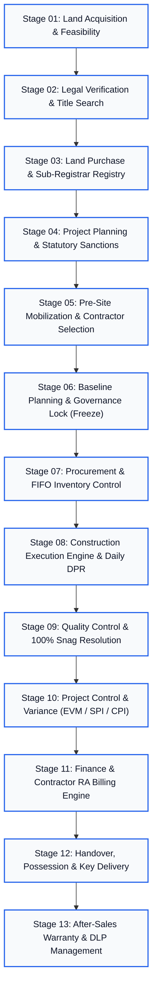
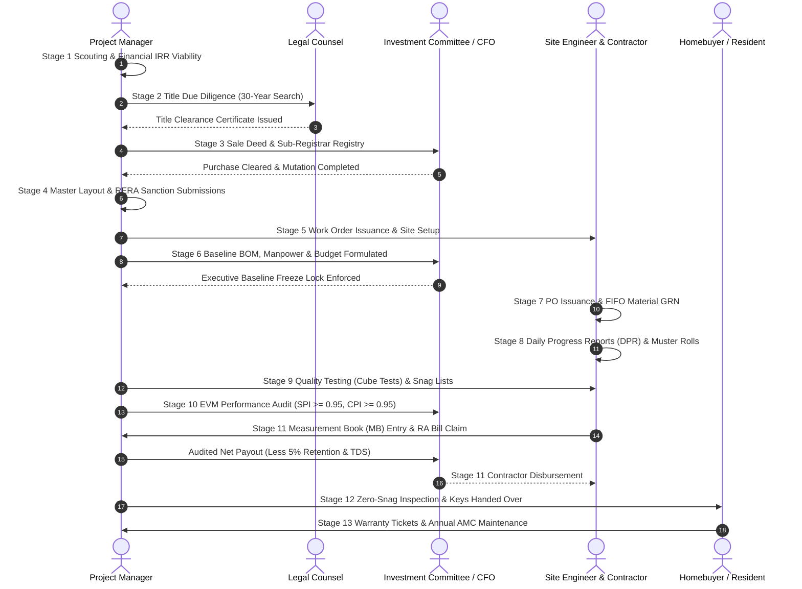

# PMS Master Architecture — End-to-End Business Flow & Governance

## 1. What is the TaskFlow PMS Engine?
The **TaskFlow Project Management System (PMS)** is an enterprise governance platform purpose-built for real estate and civil infrastructure development. It controls a project's entire lifespan across **13 mandatory stages**—from scouting raw agricultural land, through legal verification, municipal sanctions, civil construction, contractor billing, unit possession, and 10-year defect liability warranty.

---

## 2. Why Real Estate Projects Need This System
Traditional real estate projects suffer from four critical failure points:
1. **Title Risk & Land Disputes**: Buying land with hidden mortgages or court cases leads to frozen projects and court litigation.
2. **Budget Slippage & Hidden Costs**: Contractors claim inflated quantities because site measurements are not matched against baseline estimates.
3. **Ghost Materials & Theft**: Cement and steel delivered to sites disappear without automated FIFO inventory reconciliation.
4. **Customer Distrust & Snags**: Delivering homes with plumbing leaks or paint defects destroys reputation and delays final customer collections.

**TaskFlow PMS eliminates these risks** by enforcing a **single-direction governance rail**: no stage can be bypassed, no contractor can be paid without verified field measurements, and all changes require executive baseline change orders.

---

## 3. High-Level 13-Stage Lifecycle Diagram

---

## 4. Cross-Stage Data Governance Sequence

---

## 5. Overview of All 13 Submodules

| Stage # | Stage Name | Real-World Business Function | Key Deliverable |
|:---|:---|:---|:---|
| **01** | Land Acquisition & Feasibility | Land scouting, GPS coordinates, financial pro-forma ROI/IRR analysis | Investment Committee Feasibility Scorecard |
| **02** | Legal Verification | 30-year Sub-Registrar search, encumbrance check, public notice | Advocate Title Clearance Certificate |
| **03** | Land Purchase & Registry | Agreement for sale, stamp duty, Sub-Registrar deed, revenue mutation | Registered Sale Deed & Updated Khata/RTC |
| **04** | Project Planning & Sanctions | Master layout blue-prints, road networks, amenity plans, RERA approvals | Approved Master Layout & Civil Budget |
| **05** | Pre-Site Mobilization | Contractor vetting, unit rate cards, work orders, temporary site utilities | Signed Work Order & Mobilized Site Office |
| **06** | Baseline Planning & Lock | Material BOM, labor gangs, critical path schedule, cashflow projection | Executive Baseline Lock (Target Budget Freeze) |
| **07** | Procurement & FIFO Stock | Vendor POs, gate pass GRNs, warehouse stacking, contractor stock issue | FIFO Landed Cost Stock Ledger |
| **08** | Construction Execution Engine | Daily Progress Reports (DPR), labor muster rolls, equipment tracking | Certified Milestone Progress Logs |
| **09** | Quality Control & Snags | Concrete cube crushing strength, MEP pressure tests, snag rectification | Zero-Snag Quality Clearance Certificate |
| **10** | Project Control & Variance | Earned Value Management (EVM), Cost Variance (CV), Schedule Variance (SV) | Executive EVM Dashboard (CPI / SPI) |
| **11** | Finance & RA Billing | Measurement Book (MB), contractor Running Account bills, TDS/Retention | Net Audited Contractor Disbursement Advice |
| **12** | Handover & Possession | Municipal Occupancy Certificate (OC), deep cleaning, key delivery | Signed Customer Possession Certificate |
| **13** | After-Sales & DLP Warranty | 10-year structural defect liability, 1-year MEP warranty, quarterly AMC | Homebuyer NPS Score & Retention Release |

---

## 6. How to Explain This to Your Manager in 2 Minutes
> *"Sir, we have implemented an end-to-end, single-direction real estate governance engine that covers all 13 stages of project development. It guarantees financial discipline because contractors cannot be paid until work is recorded in daily progress reports and quality-tested for zero snags. Materials are tracked via FIFO batches so inventory cannot leak. Most importantly, projects are locked against an executive baseline at Stage 6, ensuring that any cost overrun or schedule delay is immediately detected in Stage 10 Variance Control with PMI-standard CPI and SPI indices. Every stage has structured checklists, approval gates, and interactive KPI dashboards with live project data."*
