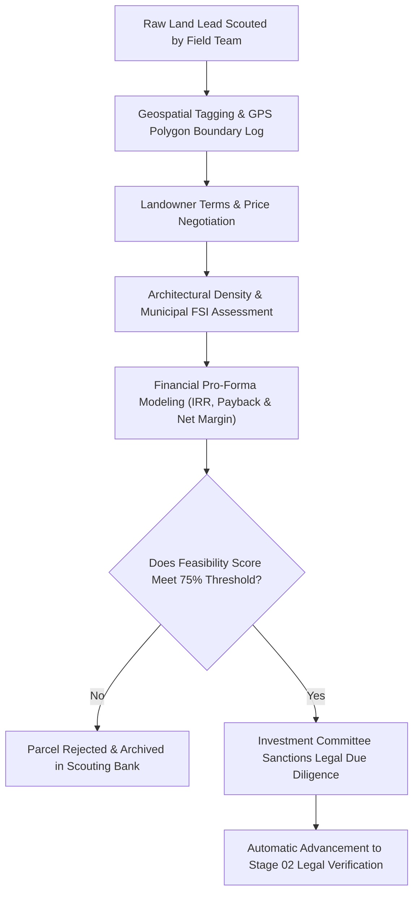

# Stage 01: Land Acquisition & Feasibility Study

## 1. What is this Stage in Plain English?
Stage 01 is where a real estate project is born. The acquisition team scouts raw land parcels, records their exact satellite GPS coordinates, interviews the landowners on price expectations, and performs detailed financial and architectural feasibility calculations to decide if the plot is profitable.

- **Primary System Route**: `/pms/plots`
- **Module Classification**: Stage 01 of 13 in the TaskFlow PMS Governance Rail

---

## 2. Why Real Estate Developers Need This Stage (The Problem It Solves)
Real estate developers often lose crores by giving non-refundable tokens on land parcels that later turn out to have zoning restrictions (green belts, flood zones) or poor financial returns. Stage 01 forces a quantitative feasibility scorecard before any money leaves the company bank account.

---

## 3. Core Terminology Explained Simply
To help you explain this stage comfortably to your manager or non-technical team members, here are the essential industry terms used in this stage:

- **FSI (Floor Space Index)**: The ratio of allowable built-up construction area relative to the total plot area (e.g. FSI of 2.0 on 10,000 sq ft allows 20,000 sq ft of built construction).

- **IRR (Internal Rate of Return)**: The annualized rate of expected earnings generated by the real estate project over its development horizon.

- **Survey Number**: The unique identification code assigned to a piece of land by the State Revenue Department for tax and boundary mapping.

- **Setback Limits**: Mandatory minimum distances that must be kept clear between physical building walls and the external plot boundary for fire access and road widening.

---

## 4. Step-by-Step Business Process Walkthrough
This stage runs according to the following chronological business sequence:

### Step 1: Scouting & Geospatial Tagging
 Field surveyors locate land parcels and pin GPS boundary polygons into the system.

### Step 2: Landowner Expectations & Valuation
 The acquisition team documents owner asking price, payment structure expectations, and joint-development proposals.

### Step 3: Topography & Soil Assessment
 Soil bearing capacity, water table depth, electrical grid proximity, and access road width are recorded.

### Step 4: Architectural Layout Potential
 Architects test potential plot typologies, roads, and green spaces against municipal zoning master plans.

### Step 5: Financial Viability Simulation
 Projected revenue from plot/villa sales is balanced against land purchase and development costs to calculate ROI and payback period.

### Step 6: Investment Committee Gate
 The project requires a minimum feasibility score (>= 75%) to clear Stage 01 and unlock Stage 02 Legal Verification.

---

## 5. Visual Process Workflow Diagram

---

## 6. Key People & Roles Involved

| Role | Operational Responsibility |
|:---|:---|
| **Land Acquisition Lead** | Discovers land parcels and leads price negotiations. |
| **Chartered Surveyor** | Performs physical boundary and contour measurements. |
| **Chief Financial Analyst** | Calculates project IRR, cashflows, and capital expenditure needs. |
| **Investment Committee** | Reviews financial feasibility scorecard and authorizes advancing to Stage 02. |

---

## 7. Dashboard KPI Summary Cards Explained
The top header of the module features 5 high-impact metrics cards. Clicking any card automatically filters the records table below:

| Card # | Metric Title | What It Measures | Filter Key Trigger |
|:---|:---|:---|:---|
| **1** | **Total Plots** | Total scouted parcels registered in database | `all` |
| **2** | **Under Visit / Analysis** | Parcels currently undergoing site topography and soil checks | `visitScheduled` |
| **3** | **Feasibility Complete** | Plots with calculated IRR and civil viability scores | `underAnalysis` |
| **4** | **Approved for Purchase** | Management-approved plots cleared for legal audit | `approved` |
| **5** | **Total Scouted Acreage** | Cumulative land area scouted across regions | `acreage` |

---

## 8. Stage Gate & Checklist Automation Criteria
To ensure complete governance, this stage cannot be marked complete until the following rules are satisfied:
1. **100% Mandatory Fields Completed**: All section forms must be populated and verified.
2. **Document Attachments Uploaded**: Key verification documents and photos must be uploaded.
3. **Authorized Officer Sign-off**: Digital verification stamps are saved in the immutable `statusHistory` log.
4. **Automatic Project Rail Advancement**: Once approved, the master project state automatically advances to the next stage on the project header rail.

---

## 9. 60-Second Presentation Pitch for Your Manager
> *"**Stage 01 protects our capital. We scout land scientifically, calculate projected returns upfront, and ensure that only financially viable plots with verified access roads advance to legal due diligence.**"*
