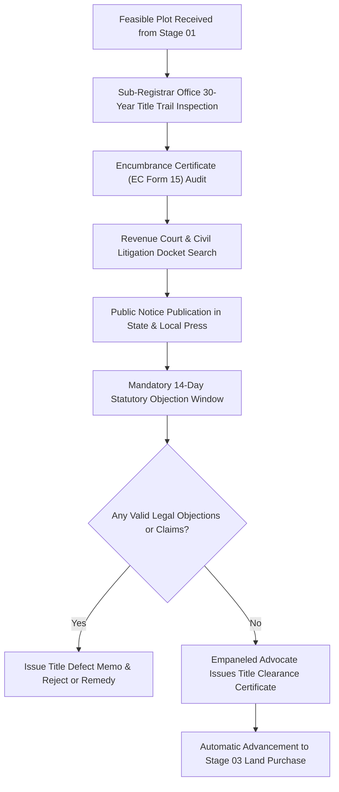

# Stage 02: Legal Verification & Title Due Diligence

## 1. What is this Stage in Plain English?
Stage 02 performs a deep legal audit on the scouted land parcel. Empaneled advocates inspect 30 to 50 years of historical sale deeds, check for bank mortgages, search revenue court records for family disputes, and publish a public notice in daily newspapers to flush out any hidden claims.

- **Primary System Route**: `/pms/legal-cases`
- **Module Classification**: Stage 02 of 13 in the TaskFlow PMS Governance Rail

---

## 2. Why Real Estate Developers Need This Stage (The Problem It Solves)
Land disputes can freeze a real estate development for 15+ years in civil courts. Developers who skip thorough title searches risk finding out that the seller did not own 100% of the land or that an undisclosed bank mortgage exists. Stage 02 makes title clearance a non-negotiable prerequisite.

---

## 3. Core Terminology Explained Simply
To help you explain this stage comfortably to your manager or non-technical team members, here are the essential industry terms used in this stage:

- **Title Search (30-Year Search)**: Examining the chain of custody of all registered deeds over the last 30+ years to confirm undisputed ownership.

- **Encumbrance Certificate (EC)**: A government-issued certificate (Form 15/16) confirming whether the property has registered mortgages, liens, or legal liabilities.

- **Public Notice**: A formal legal advertisement published in state and local newspapers giving 14 days for any third-party claimants to submit written objections.

- **Title Clearance Certificate (TCC)**: A signed, legally binding certificate issued by a senior High Court/District advocate declaring the title marketable and free from encumbrances.

---

## 4. Step-by-Step Business Process Walkthrough
This stage runs according to the following chronological business sequence:

### Step 1: Sub-Registrar Archives Inspection
 Advocates inspect volume books and registration records dating back at least 30 years.

### Step 2: Encumbrance Verification
 Form 15 is downloaded and audited to confirm no banks or lenders hold charges on the land.

### Step 3: Revenue & Civil Court Audit
 District collector and civil court records are screened for pending land acquisition or inheritance disputes.

### Step 4: Statutory Public Notice
 Formal notices are published in English and vernacular daily newspapers with a mandatory 14-day objection window.

### Step 5: Objection Audit
 If no valid objections are lodged within 14 days, the advocate issues a formal Title Clearance Certificate.

### Step 6: Stage Gate Approval
 Stage 03 Land Purchase is strictly locked until the Title Clearance Certificate is digitally uploaded and approved.

---

## 5. Visual Process Workflow Diagram

---

## 6. Key People & Roles Involved

| Role | Operational Responsibility |
|:---|:---|
| **Empaneled Legal Advocate** | Conducts title search and drafts legal opinions. |
| **Revenue Document Liaison** | Extracts historical 7/12, RTC, mutation, and index entries. |
| **Head of Legal & Compliance** | Reviews advocate opinion and authorizes legal sanction. |

---

## 7. Dashboard KPI Summary Cards Explained
The top header of the module features 5 high-impact metrics cards. Clicking any card automatically filters the records table below:

| Card # | Metric Title | What It Measures | Filter Key Trigger |
|:---|:---|:---|:---|
| **1** | **Total Legal Cases** | All active legal audit records | `all` |
| **2** | **Under Search** | Cases undergoing Sub-Registrar records lookup | `underSearch` |
| **3** | **Public Notice Active** | Newspaper publication running 14-day claim window | `noticeActive` |
| **4** | **Title Clear** | Advocate certified parcels free from encumbrance | `titleClear` |
| **5** | **Litigation / High Risk** | Parcels flagged with active litigation or boundary issues | `litigationFlagged` |

---

## 8. Stage Gate & Checklist Automation Criteria
To ensure complete governance, this stage cannot be marked complete until the following rules are satisfied:
1. **100% Mandatory Fields Completed**: All section forms must be populated and verified.
2. **Document Attachments Uploaded**: Key verification documents and photos must be uploaded.
3. **Authorized Officer Sign-off**: Digital verification stamps are saved in the immutable `statusHistory` log.
4. **Automatic Project Rail Advancement**: Once approved, the master project state automatically advances to the next stage on the project header rail.

---

## 9. 60-Second Presentation Pitch for Your Manager
> *"**Stage 02 guarantees zero legal risk. We conduct an exhaustive 30-year title search, publish newspaper public notices, and mandate an advocate Title Clearance Certificate before paying the seller.**"*
