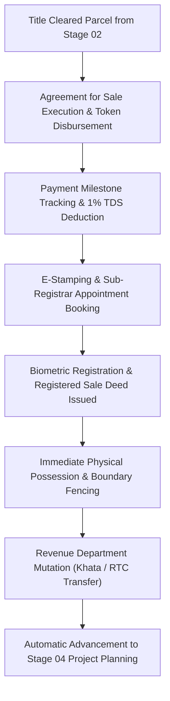

# Stage 03: Land Purchase & Sub-Registrar Registry

## 1. What is this Stage in Plain English?
Stage 03 executes the formal purchase transaction: executing the registered Agreement for Sale, scheduling payment milestones, paying government stamp duty, executing the Sale Deed before the Sub-Registrar, taking physical possession, and mutating land revenue records into company name.

- **Primary System Route**: `/pms/land-purchases`
- **Module Classification**: Stage 03 of 13 in the TaskFlow PMS Governance Rail

---

## 2. Why Real Estate Developers Need This Stage (The Problem It Solves)
Informal land deals often result in seller disputes, delayed stamp duty penalties, or failure to update government revenue records (Mutation/Khata). If mutation is delayed, the previous owner can illegally attempt to resell the land. Stage 03 governs every rupee and seals revenue mutation.

---

## 3. Core Terminology Explained Simply
To help you explain this stage comfortably to your manager or non-technical team members, here are the essential industry terms used in this stage:

- **Agreement for Sale**: A legally binding contract detailing consideration terms, payment dates, and obligations prior to registration.

- **Stamp Duty & Registration Fee**: State government taxes paid to legally validate property ownership transfer (typically 5% to 8% of property market value).

- **Sub-Registrar Office (SRO)**: The state government authority responsible for officially recording property deeds and biometric seller/buyer consent.

- **Revenue Mutation (Khata / 7-12 Transfer)**: Updating the local revenue registry to officially reflect the company as the lawful tax-paying owner.

---

## 4. Step-by-Step Business Process Walkthrough
This stage runs according to the following chronological business sequence:

### Step 1: Agreement for Sale Drafting
 Legal contracts are drawn with milestones, default penalties, and boundary schedules.

### Step 2: Milestone Payment Releases
 Token, earnest money, and registration balances are disbursed with mandatory 1% TDS deduction under section 194-IA.

### Step 3: E-Stamping & Fee Payment
 Government challans for stamp duty and registration fees are generated and verified.

### Step 4: Sub-Registrar Registration
 Buyer and seller appear before the Sub-Registrar for biometric authentication, photograph, and deed registration.

### Step 5: Physical Demarcation
 Company boundary pillars and fencing are erected immediately upon registration.

### Step 6: Tehsildar Mutation
 Revenue records (Khata / RTC / 7-12 extract) are updated into company name, unlocking Stage 04 Project Planning.

---

## 5. Visual Process Workflow Diagram

---

## 6. Key People & Roles Involved

| Role | Operational Responsibility |
|:---|:---|
| **Finance / Treasury Officer** | Coordinates bank drafts, RTGS transfers, and TDS payments. |
| **Registration Liaison** | Manages appointments, e-challans, and biometric appointments at SRO. |
| **Survey Boundary Engineer** | Installs physical boundary pillars and boundary fences. |

---

## 7. Dashboard KPI Summary Cards Explained
The top header of the module features 5 high-impact metrics cards. Clicking any card automatically filters the records table below:

| Card # | Metric Title | What It Measures | Filter Key Trigger |
|:---|:---|:---|:---|
| **1** | **Total Land Purchases** | Total purchase transactions recorded | `all` |
| **2** | **Agreement Phase** | Deals with executed agreement to sell awaiting registration | `agreementPhase` |
| **3** | **Registration Scheduled** | Awaiting appointment at Sub-Registrar office | `registrationScheduled` |
| **4** | **Registered & Mutated** | Fully registered with updated revenue records | `registered` |
| **5** | **Total Land Capital Deployed** | Cumulative capital invested in land acquisition | `capital` |

---

## 8. Stage Gate & Checklist Automation Criteria
To ensure complete governance, this stage cannot be marked complete until the following rules are satisfied:
1. **100% Mandatory Fields Completed**: All section forms must be populated and verified.
2. **Document Attachments Uploaded**: Key verification documents and photos must be uploaded.
3. **Authorized Officer Sign-off**: Digital verification stamps are saved in the immutable `statusHistory` log.
4. **Automatic Project Rail Advancement**: Once approved, the master project state automatically advances to the next stage on the project header rail.

---

## 9. 60-Second Presentation Pitch for Your Manager
> *"**Stage 03 manages our land capital deployment. We ensure every sale deed is biometrically registered, tax deductions are verified, and government revenue mutation is completed so our title is indisputable.**"*
