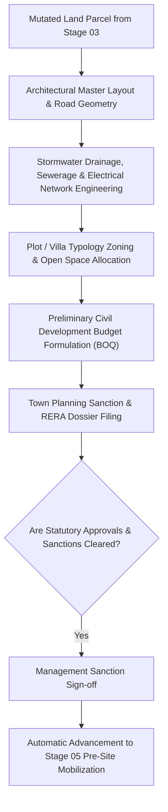

# Stage 04: Project Planning & Statutory Sanctions

## 1. What is this Stage in Plain English?
Stage 04 transforms raw mutated land into an engineered master plan. Architects and civil engineers design the road layout, stormwater drainage, amenity spaces (clubhouse, parks, utility yards), plot/villa typology zoning, and compile the preliminary civil development budget while submitting files for RERA and town planning sanctions.

- **Primary System Route**: `/pms/planning`
- **Module Classification**: Stage 04 of 13 in the TaskFlow PMS Governance Rail

---

## 2. Why Real Estate Developers Need This Stage (The Problem It Solves)
Starting site work without coordinated layouts leads to redesigns, wasted excavation, non-compliant road widths, and regulatory fines under RERA. Stage 04 creates the blueprint master plan and links it directly to development budgeting.

---

## 3. Core Terminology Explained Simply
To help you explain this stage comfortably to your manager or non-technical team members, here are the essential industry terms used in this stage:

- **Master Layout Plan**: The comprehensive site blueprint showing internal roads, plots, public open spaces, and utility reservations.

- **RERA (Real Estate Regulatory Authority)**: The statutory body that protects buyers and requires developers to register project layouts, timelines, and budgets before marketing.

- **BOQ (Bill of Quantities)**: An itemized schedule of civil works detailing estimated quantities (cubic meters of concrete, metric tons of steel, linear meters of piping).

- **Statutory Sanction**: Formal legal approvals granted by local municipal bodies, town planning authorities, fire safety, and pollution control boards.

---

## 4. Step-by-Step Business Process Walkthrough
This stage runs according to the following chronological business sequence:

### Step 1: Topographical Master Layout
 Architects design road geometry, drainage slopes, and plot divisions conforming to local building bye-laws.

### Step 2: Utility & Infrastructure Design
 Engineers calculate storm water runoff, sewage treatment plant (STP) capacity, and electrical transformer locations.

### Step 3: Amenity & Typology Allocation
 Plots and villas are categorized by size (e.g., 30x40, 40x60), orientation, and park proximity.

### Step 4: Development Budgeting
 Civil engineers compute initial BOQ cost estimates for earthwork, asphalt roads, curbs, and streetlighting.

### Step 5: Statutory & RERA Submissions
 Sanction dossiers are submitted to the municipal authority and the State RERA authority.

### Step 6: Management Approval Gate
 Once layouts are sanctioned and preliminary budgets are approved, the project unlocks Stage 05 Pre-Site Start.

---

## 5. Visual Process Workflow Diagram

---

## 6. Key People & Roles Involved

| Role | Operational Responsibility |
|:---|:---|
| **Chief Architect / Urban Planner** | Designs layout and road connectivity. |
| **Infrastructure Civil Engineer** | Calculates drainage slopes, utility networks, and BOQ. |
| **Liaison & Sanctions Officer** | Coordinates municipal and RERA approvals. |

---

## 7. Dashboard KPI Summary Cards Explained
The top header of the module features 5 high-impact metrics cards. Clicking any card automatically filters the records table below:

| Card # | Metric Title | What It Measures | Filter Key Trigger |
|:---|:---|:---|:---|
| **1** | **Total Plans** | Total registered project planning & design master records | `all` |
| **2** | **In Planning** | Projects actively progressing through design stages | `inPlanning` |
| **3** | **Awaiting Sanction** | Completed designs pending municipal or management sanction | `managementApproval` |
| **4** | **Approved Plans** | Fully sanctioned plans cleared for contractor selection | `approved` |
| **5** | **Total Dev Budget** | Cumulative estimated civil infrastructure development budget | `hasBudget` |

---

## 8. Stage Gate & Checklist Automation Criteria
To ensure complete governance, this stage cannot be marked complete until the following rules are satisfied:
1. **100% Mandatory Fields Completed**: All section forms must be populated and verified.
2. **Document Attachments Uploaded**: Key verification documents and photos must be uploaded.
3. **Authorized Officer Sign-off**: Digital verification stamps are saved in the immutable `statusHistory` log.
4. **Automatic Project Rail Advancement**: Once approved, the master project state automatically advances to the next stage on the project header rail.

---

## 9. 60-Second Presentation Pitch for Your Manager
> *"**Stage 04 establishes our engineering and regulatory foundation. We create fully sanctioned layouts and preliminary development budgets to eliminate design revisions and ensure 100% RERA compliance.**"*
