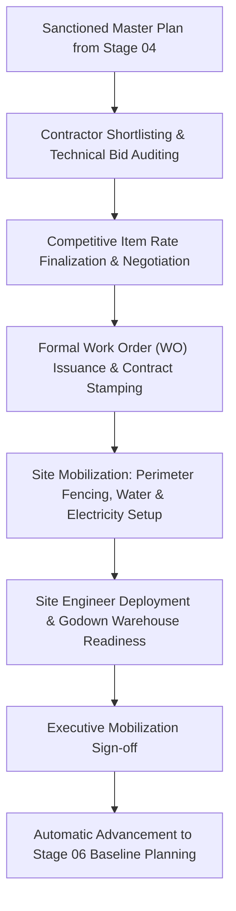

# Stage 05: Pre-Site Mobilization & Contractor Selection

## 1. What is this Stage in Plain English?
Stage 05 prepares the physical site for ground-breaking. It shortlists qualified civil contractors, negotiates itemized unit rates (concrete casting, excavation, masonry), executes formal Work Orders, and sets up temporary site electricity, borewell water, security fencing, and the engineer site office.

- **Primary System Route**: `/pms/pre-site`
- **Module Classification**: Stage 05 of 13 in the TaskFlow PMS Governance Rail

---

## 2. Why Real Estate Developers Need This Stage (The Problem It Solves)
Allowing contractors onto a project without signed contracts, fixed unit rates, or site utilities results in contractor abandonment, rate disputes, safety hazards, and immediate project stalls. Stage 05 ensures complete contractual and logistical readiness.

---

## 3. Core Terminology Explained Simply
To help you explain this stage comfortably to your manager or non-technical team members, here are the essential industry terms used in this stage:

- **Work Order (WO)**: A legally binding contract between the developer and contractor defining project scope, item rates, milestone schedules, and penalty clauses.

- **Item Rate Card**: The agreed fixed unit price for each unit of construction work (e.g. ₹4,500 per cubic meter of RCC concrete, ₹120 per cubic meter of soil excavation).

- **Site Mobilization**: Erecting perimeter security fences, connecting water/power utilities, setting up material godowns, and deploying supervisory staff.

- **Defect Liability Period (Contractor)**: A contractual clause requiring the contractor to repair workmanship defects free of charge for 12 months after completion.

---

## 4. Step-by-Step Business Process Walkthrough
This stage runs according to the following chronological business sequence:

### Step 1: Contractor Prequalification
 Contractor track records, past projects, machinery fleet, and financial health are audited.

### Step 2: Competitive Rate Negotiation
 Bids are benchmarked across item categories to establish the lowest competitive rate card.

### Step 3: Formal Work Order Execution
 Contracts are digitally stamped with milestones, retention terms, and penalty stipulations.

### Step 4: Temporary Site Utilities
 Borewells, temporary 3-phase power, high-security store godowns, and worker amenities are established.

### Step 5: Deployment of Site Engineering Gangs
 Project site engineers, safety officers, and quality leads take charge of physical site access.

### Step 6: Pre-Site Sign-off
 Management verifies physical readiness, unlocking Stage 06 Baseline Planning.

---

## 5. Visual Process Workflow Diagram

---

## 6. Key People & Roles Involved

| Role | Operational Responsibility |
|:---|:---|
| **Procurement & Contracts Lead** | Negotiates rate cards and executes contractor Work Orders. |
| **Site In-Charge Engineer** | Supervises temporary site utility setup and warehouse fencing. |
| **Safety Officer** | Establishes safety signage, PPE compliance, and worker welfare facilities. |

---

## 7. Dashboard KPI Summary Cards Explained
The top header of the module features 5 high-impact metrics cards. Clicking any card automatically filters the records table below:

| Card # | Metric Title | What It Measures | Filter Key Trigger |
|:---|:---|:---|:---|
| **1** | **Total Workflows** | Total pre-site mobilization workflows registered | `all` |
| **2** | **In Procurement** | Active contractor bidding and rate negotiations | `inPreSite` |
| **3** | **Awaiting Sign-off** | Completed setups awaiting management approval | `managementApproval` |
| **4** | **Mobilized & Approved** | Sites fully mobilized with deployed engineering teams | `approved` |
| **5** | **Total Work Orders** | Cumulative value of executed contractor agreements | `hasWorkOrder` |

---

## 8. Stage Gate & Checklist Automation Criteria
To ensure complete governance, this stage cannot be marked complete until the following rules are satisfied:
1. **100% Mandatory Fields Completed**: All section forms must be populated and verified.
2. **Document Attachments Uploaded**: Key verification documents and photos must be uploaded.
3. **Authorized Officer Sign-off**: Digital verification stamps are saved in the immutable `statusHistory` log.
4. **Automatic Project Rail Advancement**: Once approved, the master project state automatically advances to the next stage on the project header rail.

---

## 9. 60-Second Presentation Pitch for Your Manager
> *"**Stage 05 eliminates contractor ambiguity. We lock competitive unit rate cards, execute formal work orders, and prepare on-site utilities before construction commences.**"*
