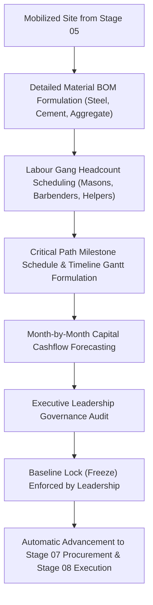

# Stage 06: Baseline Planning & Governance Lock

## 1. What is this Stage in Plain English?
Stage 06 is the project commitment gate. Here, project engineers lock down the target Bill of Materials (BOM), planned labor gang headcounts, critical milestone timelines, and monthly cashflow requirements. Once reviewed, executive leadership enforces an immutable Baseline Lock (Freeze) that prevents unapproved budget alterations.

- **Primary System Route**: `/pms/baseline`
- **Module Classification**: Stage 06 of 13 in the TaskFlow PMS Governance Rail

---

## 2. Why Real Estate Developers Need This Stage (The Problem It Solves)
Without an immutable baseline, budgets continuously inflate and project managers shift deadlines backward to hide delays. Stage 06 freezes the original scope, schedule, and budget so that all future cost and schedule variances can be audited scientifically.

---

## 3. Core Terminology Explained Simply
To help you explain this stage comfortably to your manager or non-technical team members, here are the essential industry terms used in this stage:

- **BOM (Bill of Materials)**: The master inventory schedule specifying the exact quantity and grade of cement, TMT steel, aggregate, pipes, and bricks required for the entire project.

- **Labour Gang**: A specialized construction team consisting of a head mason, bar benders, carpenters, and helpers operating together.

- **Baseline Freeze / Lock**: A digital governance freeze that locks the project scope, budget, and timeline. No user can alter these numbers without a formal change order.

- **Cashflow Pro-Forma**: A month-by-month financial projection mapping capital outflows (procurement & labour) against anticipated customer collections.

---

## 4. Step-by-Step Business Process Walkthrough
This stage runs according to the following chronological business sequence:

### Step 1: Material BOM Matrix
 Engineers detail expected consumption across each major material grade with target purchase unit rates.

### Step 2: Labour Gang Scheduling
 Headcounts for daily peak, average, and specialized manpower are mapped per work package.

### Step 3: Milestone Timeline Scheduling
 Key civil milestones (earthwork, drainage, paving, landscaping) are plotted with critical path logic.

### Step 4: Cashflow Modeling
 Monthly capital expenditure drawdowns are finalized to secure treasury financing.

### Step 5: Executive Baseline Governance Review
 Senior leadership audits the planned margin, schedule duration, and contingency reserves.

### Step 6: Enforcing Baseline Lock
 The baseline is digitally frozen. Once locked, the project unlocks Stage 07 Procurement and Stage 08 Construction.

---

## 5. Visual Process Workflow Diagram

---

## 6. Key People & Roles Involved

| Role | Operational Responsibility |
|:---|:---|
| **Project Director** | Formulates baseline milestones and BOM targets. |
| **Chief Financial Officer (CFO)** | Audits cashflow drawdowns and capital allocation. |
| **Executive Managing Director** | Enforces the formal digital Baseline Lock signature. |

---

## 7. Dashboard KPI Summary Cards Explained
The top header of the module features 5 high-impact metrics cards. Clicking any card automatically filters the records table below:

| Card # | Metric Title | What It Measures | Filter Key Trigger |
|:---|:---|:---|:---|
| **1** | **Total Baselines** | Total registered project baseline master plans | `all` |
| **2** | **In Planning** | Formulating BOM, labor gangs, or cashflows | `inPlanning` |
| **3** | **Awaiting Lock** | Complete baselines awaiting executive freeze | `baselineReview` |
| **4** | **Frozen & Locked** | Baselines officially frozen for execution monitoring | `locked` |
| **5** | **Total Baseline Budget** | Cumulative baseline budget allocation across all projects | `hasBudget` |

---

## 8. Stage Gate & Checklist Automation Criteria
To ensure complete governance, this stage cannot be marked complete until the following rules are satisfied:
1. **100% Mandatory Fields Completed**: All section forms must be populated and verified.
2. **Document Attachments Uploaded**: Key verification documents and photos must be uploaded.
3. **Authorized Officer Sign-off**: Digital verification stamps are saved in the immutable `statusHistory` log.
4. **Automatic Project Rail Advancement**: Once approved, the master project state automatically advances to the next stage on the project header rail.

---

## 9. 60-Second Presentation Pitch for Your Manager
> *"**Stage 06 provides our project benchmark. We freeze the BOM, labor headcount, schedule, and budget so leadership has an unalterable standard to measure actual field execution against.**"*
