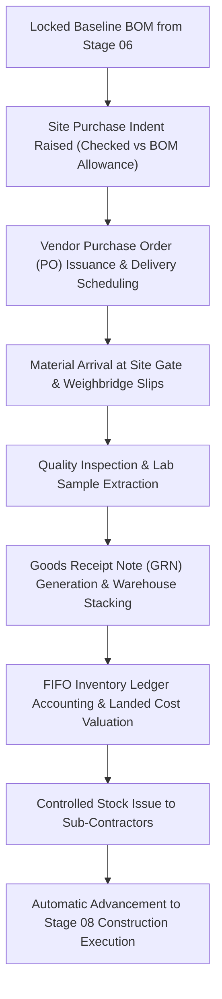

# Stage 07: Procurement & FIFO Inventory Management

## 1. What is this Stage in Plain English?
Stage 07 manages the construction supply chain. Site engineers raise material purchase indents against the approved baseline BOM, procurement issues purchase orders to verified vendors, incoming trucks are inspected at the gate with Goods Receipt Notes (GRN), materials are warehoused, and inventory is issued to sub-contractors on a First-In-First-Out (FIFO) basis.

- **Primary System Route**: `/pms/procurement`
- **Module Classification**: Stage 07 of 13 in the TaskFlow PMS Governance Rail

---

## 2. Why Real Estate Developers Need This Stage (The Problem It Solves)
Material costs account for 60% of civil construction. Sites frequently suffer from double-ordering, delivery of substandard materials, ghost shipments, and material theft. Stage 07 tracks every bag of cement and ton of steel from vendor invoice to contractor consumption.

---

## 3. Core Terminology Explained Simply
To help you explain this stage comfortably to your manager or non-technical team members, here are the essential industry terms used in this stage:

- **Indent / Purchase Requisition**: A formal internal request raised by a site engineer stating the item, quantity, and required delivery date.

- **Purchase Order (PO)**: The commercial contract dispatched to an approved vendor specifying item specs, delivery timeline, tax terms, and payment milestones.

- **Goods Receipt Note (GRN)**: The official document generated at the site gate after physical weighment, quality testing, and bill verification.

- **FIFO (First-In, First-Out)**: An inventory accounting method where materials received earliest are issued first, ensuring accurate landed cost tracking and preventing material degradation.

---

## 4. Step-by-Step Business Process Walkthrough
This stage runs according to the following chronological business sequence:

### Step 1: Indent Validation
 Site engineers submit material indents, which the system automatically checks against remaining baseline BOM allowances.

### Step 2: Vendor PO Issuance
 Commercial purchase orders are dispatched to approved vendors with delivery deadlines.

### Step 3: Gate Inward & Inspection
 Trucks arrive at site gate; security checks weighbridge slips, delivery challans, and physical counts.

### Step 4: Quality Lab Sampling
 Lab technicians draw concrete and steel samples before authorizing unloading into warehouses.

### Step 5: GRN Creation & FIFO Stacking
 Official GRNs are generated and batch codes are assigned to inventory stacks.

### Step 6: Stock Issue to Contractors
 Material is issued only against formal contractor requisitions linked to their active work order.

---

## 5. Visual Process Workflow Diagram

---

## 6. Key People & Roles Involved

| Role | Operational Responsibility |
|:---|:---|
| **Site Storekeeper** | Inspects incoming deliveries, verifies challans, and issues stock. |
| **Purchase Manager** | Negotiates vendor pricing and tracks PO delivery schedules. |
| **Quality Control Technician** | Draws field samples of cement, steel, and sand. |

---

## 7. Dashboard KPI Summary Cards Explained
The top header of the module features 5 high-impact metrics cards. Clicking any card automatically filters the records table below:

| Card # | Metric Title | What It Measures | Filter Key Trigger |
|:---|:---|:---|:---|
| **1** | **Total Procurement Records** | All procurement tracking records | `all` |
| **2** | **Active Indents** | Material requisitions currently being processed | `activeIndents` |
| **3** | **PO Dispatched** | Orders placed with vendors awaiting shipment | `poDispatched` |
| **4** | **GRN Inwarded** | Materials received and accepted into store | `grnInwarded` |
| **5** | **Warehouse Stock Value** | Total book value of inventory currently in site store | `stockValue` |

---

## 8. Stage Gate & Checklist Automation Criteria
To ensure complete governance, this stage cannot be marked complete until the following rules are satisfied:
1. **100% Mandatory Fields Completed**: All section forms must be populated and verified.
2. **Document Attachments Uploaded**: Key verification documents and photos must be uploaded.
3. **Authorized Officer Sign-off**: Digital verification stamps are saved in the immutable `statusHistory` log.
4. **Automatic Project Rail Advancement**: Once approved, the master project state automatically advances to the next stage on the project header rail.

---

## 9. 60-Second Presentation Pitch for Your Manager
> *"**Stage 07 controls our largest expense. We validate every purchase against the baseline BOM, verify physical deliveries at the gate with GRNs, and enforce FIFO inventory accounting.**"*
