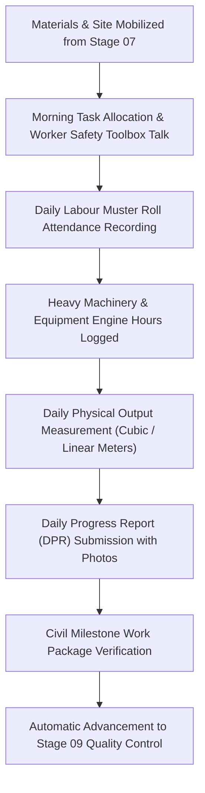

# Stage 08: Construction Execution Engine & Daily Progress (DPR)

## 1. What is this Stage in Plain English?
Stage 08 is the heartbeat of on-site construction. Site supervisors submit Daily Progress Reports (DPR) detailing exact work completed that day, log labor muster rolls (skilled masons, helpers, machine operators), track heavy machinery operating hours (JCB, transit mixers), and capture timestamped progress photos.

- **Primary System Route**: `/pms/construction`
- **Module Classification**: Stage 08 of 13 in the TaskFlow PMS Governance Rail

---

## 2. Why Real Estate Developers Need This Stage (The Problem It Solves)
Construction projects fail silently because office management is blind to what happens on site every day. Contractors exaggerate work progress while hiding labor shortages and weather delays. Stage 08 captures objective daily field data that feeds directly into quality control and contractor billing.

---

## 3. Core Terminology Explained Simply
To help you explain this stage comfortably to your manager or non-technical team members, here are the essential industry terms used in this stage:

- **Daily Progress Report (DPR)**: The official daily log capturing physical quantities completed (e.g. 85 cubic meters of concrete poured, 120 meters of drain pipe laid).

- **Muster Roll**: The daily attendance register recording total labor headcounts by trade and contractor gang deployed on site.

- **Heavy Machinery Log**: Tracking operating vs idle engine hours for leased or company-owned construction equipment.

- **Milestone Verification**: Independent physical inspection confirming that a defined civil package (e.g. Sub-grade road compaction) is 100% complete.

---

## 4. Step-by-Step Business Process Walkthrough
This stage runs according to the following chronological business sequence:

### Step 1: Daily Work Package Briefing
 Site engineers assign daily production targets to contractor gangs during morning toolbox talks.

### Step 2: Labour Attendance Logging
 Muster roll headcounts are captured and categorized (masons, carpenters, barbenders, helpers).

### Step 3: Machinery Usage Tracking
 Engine start/stop hours and diesel consumption are recorded for excavators, rollers, and mixers.

### Step 4: Field Quantity Measurement
 At the end of each shift, actual physical output is measured and logged into the daily DPR.

### Step 5: Site Diary & Photo Capture
 Weather interruptions, government inspections, and photographic evidence are uploaded.

### Step 6: Site Engineer Sign-off
 The verified DPR updates the master project execution ledger, feeding Stage 09 Quality and Stage 11 Finance.

---

## 5. Visual Process Workflow Diagram

---

## 6. Key People & Roles Involved

| Role | Operational Responsibility |
|:---|:---|
| **Site Engineer** | Measures daily field outputs and submits the DPR. |
| **Timekeeper / Muster Officer** | Counts labor attendance and verifies contractor gang sizes. |
| **Equipment Supervisor** | Monitors fuel usage and operating hours of heavy plant machinery. |

---

## 7. Dashboard KPI Summary Cards Explained
The top header of the module features 5 high-impact metrics cards. Clicking any card automatically filters the records table below:

| Card # | Metric Title | What It Measures | Filter Key Trigger |
|:---|:---|:---|:---|
| **1** | **Active Sites** | Projects under active physical construction | `all` |
| **2** | **DPRs Logged Today** | Daily Progress Reports submitted in the current cycle | `hasDpr` |
| **3** | **On-Site Workforce** | Total labor headcounts deployed across all active sites | `laborHeadcount` |
| **4** | **Milestones Completed** | Civil milestones executed and awaiting quality check | `approved` |
| **5** | **Machinery Operating Hours** | Cumulative heavy equipment operational hours | `machinery` |

---

## 8. Stage Gate & Checklist Automation Criteria
To ensure complete governance, this stage cannot be marked complete until the following rules are satisfied:
1. **100% Mandatory Fields Completed**: All section forms must be populated and verified.
2. **Document Attachments Uploaded**: Key verification documents and photos must be uploaded.
3. **Authorized Officer Sign-off**: Digital verification stamps are saved in the immutable `statusHistory` log.
4. **Automatic Project Rail Advancement**: Once approved, the master project state automatically advances to the next stage on the project header rail.

---

## 9. 60-Second Presentation Pitch for Your Manager
> *"**Stage 08 provides total operational visibility. We log daily progress reports, verify labor attendance, and record machine utilization so leadership knows the exact status of physical construction every single day.**"*
