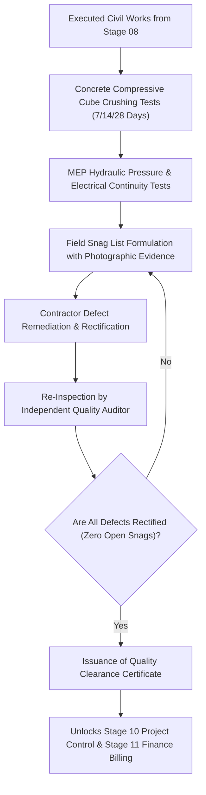

# Stage 09: Quality Control & Snag Remediation

## 1. What is this Stage in Plain English?
Stage 09 enforces engineering excellence and safety. Quality auditors conduct mandatory civil laboratory tests (concrete cube compressive strength, steel tensile tests, slump tests), perform pressure tests on water and drainage lines, create photographic snag lists for contractor defects, and verify 100% de-snagging before clearance.

- **Primary System Route**: `/pms/quality`
- **Module Classification**: Stage 09 of 13 in the TaskFlow PMS Governance Rail

---

## 2. Why Real Estate Developers Need This Stage (The Problem It Solves)
Poor quality construction leads to structural cracks, water seepage, failed municipal inspections, and angry homebuyers. In traditional setups, contractors hide defective work under plaster or paint. Stage 09 blocks contractor payment until every snag is remediated and lab tests pass.

---

## 3. Core Terminology Explained Simply
To help you explain this stage comfortably to your manager or non-technical team members, here are the essential industry terms used in this stage:

- **Concrete Cube Test**: Crushing concrete test cubes at 7, 14, and 28 days to scientifically prove that concrete achieves its designed compressive strength (e.g. M25 / M30 grade).

- **Slump Test**: A standard on-site test measuring the workability and water-cement consistency of fresh concrete before pouring.

- **Snag List**: A photographic punch-list identifying defective workmanship (hollow tiles, plaster cracks, misaligned pipes, paint blemishes).

- **De-Snagging**: The physical rectification of identified snags by the contractor, followed by mandatory re-inspection by quality auditors.

---

## 4. Step-by-Step Business Process Walkthrough
This stage runs according to the following chronological business sequence:

### Step 1: Lab Sample Testing
 Quality teams test concrete crushing strength at 7, 14, and 28-day curing intervals; test results are logged.

### Step 2: MEP Integrity Inspections
 Water supply lines are subjected to hydraulic pressure holding tests; drainage pipes are tested for slope and leaks.

### Step 3: Field Snag List Logging
 Inspectors photograph defects, assign severity ratings (Critical, High, Medium, Minor), and tag responsible contractors.

### Step 4: Contractor Rectification
 Contractors receive automated defect notices and must fix the snags within established SLA windows.

### Step 5: Re-Inspection & Verification
 Quality auditors re-inspect rectified areas, upload comparison photos, and close tickets.

### Step 6: Quality Clearance Certificate
 Once zero open snags remain and all lab tests pass, the audit certificate is issued, unlocking Stage 11 Finance.

---

## 5. Visual Process Workflow Diagram

---

## 6. Key People & Roles Involved

| Role | Operational Responsibility |
|:---|:---|
| **Quality Assurance (QA) Manager** | Audits lab test certificates and signs off quality certificates. |
| **Quality Control Inspector** | Walks sites, photographs defects, and maintains snag registers. |
| **Materials Testing Lab Tech** | Performs compression machine tests on concrete and slump tests. |

---

## 7. Dashboard KPI Summary Cards Explained
The top header of the module features 5 high-impact metrics cards. Clicking any card automatically filters the records table below:

| Card # | Metric Title | What It Measures | Filter Key Trigger |
|:---|:---|:---|:---|
| **1** | **Quality Audits** | Total quality control and snagging audit records | `all` |
| **2** | **Inspections in Progress** | Active field audits undergoing verification | `inProgress` |
| **3** | **Open Snags** | Identified defects currently under contractor remediation | `hasOpenSnags` |
| **4** | **Certified Zero-Snag** | Audits with 100% defects cleared and certified | `approved` |
| **5** | **Total Tests Cleared** | Cumulative lab tests passed (slump, cube, rebar) | `hasInspections` |

---

## 8. Stage Gate & Checklist Automation Criteria
To ensure complete governance, this stage cannot be marked complete until the following rules are satisfied:
1. **100% Mandatory Fields Completed**: All section forms must be populated and verified.
2. **Document Attachments Uploaded**: Key verification documents and photos must be uploaded.
3. **Authorized Officer Sign-off**: Digital verification stamps are saved in the immutable `statusHistory` log.
4. **Automatic Project Rail Advancement**: Once approved, the master project state automatically advances to the next stage on the project header rail.

---

## 9. 60-Second Presentation Pitch for Your Manager
> *"**Stage 09 protects our structural integrity and brand. We enforce concrete lab testing, photograph every snag, and mandate zero open defects before any contractor invoice can be cleared.**"*
