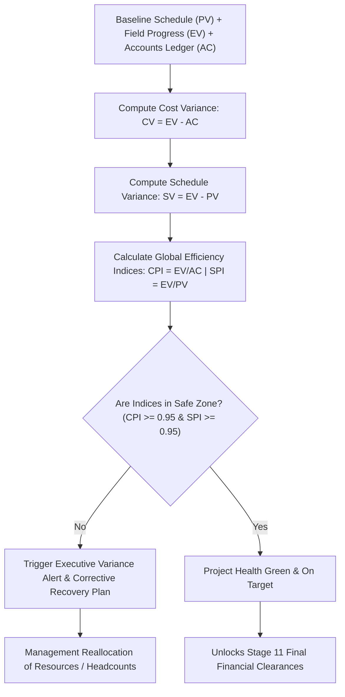

# Stage 10: Project Control & Variance (EVM / SPI / CPI)

## 1. What is this Stage in Plain English?
Stage 10 is the executive intelligence engine of PMS. It calculates PMI-standard Earned Value Management (EVM) metrics by comparing the baseline budget against actual field progress and financial disbursements. It generates Cost Variance (CV), Schedule Variance (SV), Cost Performance Index (CPI), and Schedule Performance Index (SPI) to provide instant early warnings of budget overruns or project delays.

- **Primary System Route**: `/pms/project-control`
- **Module Classification**: Stage 10 of 13 in the TaskFlow PMS Governance Rail

---

## 2. Why Real Estate Developers Need This Stage (The Problem It Solves)
In typical projects, executives only discover that a project is over budget or 6 months behind schedule when the bank funds run out. Stage 10 calculates performance indices in real time, alerting leadership months before small variances become financial disasters.

---

## 3. Core Terminology Explained Simply
To help you explain this stage comfortably to your manager or non-technical team members, here are the essential industry terms used in this stage:

- **Planned Value (PV)**: The budgeted cost of work scheduled to be completed by today according to the baseline.

- **Earned Value (EV)**: The budgeted cost of work actually completed on the ground today based on verified DPRs.

- **Actual Cost (AC)**: The actual money spent and disbursed to contractors and vendors to date.

- **Cost Performance Index (CPI)**: A measure of financial efficiency (CPI = EV / AC). A CPI of 1.0 is on budget; < 1.0 means cost overrun.

- **Schedule Performance Index (SPI)**: A measure of timeline efficiency (SPI = EV / PV). An SPI of 1.0 is on schedule; < 1.0 means project delay.

---

## 4. Step-by-Step Business Process Walkthrough
This stage runs according to the following chronological business sequence:

### Step 1: Data Consolidation
 The system combines Stage 06 Baseline (PV), Stage 08 DPR Progress (EV), and Stage 11 Finance (AC).

### Step 2: Variance Computation
 The engine calculates Cost Variance (CV = EV - AC) and Schedule Variance (SV = EV - PV).

### Step 3: Index Scoring
 CPI and SPI ratios are calculated to benchmark efficiency against global construction standards.

### Step 4: Forecast at Completion (EAC)
 The engine projects the final anticipated project cost and completion date based on current run rates.

### Step 5: Critical Variance Alerting
 If CPI or SPI drops below 0.95 (5% adverse variance), the project is flagged for executive intervention.

### Step 6: Corrective Action Formulation
 Project managers submit remediation plans (e.g. adding labour gangs or value-engineering materials) to restore project health.

---

## 5. Visual Process Workflow Diagram

---

## 6. Key People & Roles Involved

| Role | Operational Responsibility |
|:---|:---|
| **Project Controls Specialist** | Audits EVM formulas, critical paths, and schedule buffers. |
| **Chief Planning Officer** | Reviews variance trends across all regional projects. |
| **Executive Managing Director** | Intervenes when projects breach critical variance thresholds. |

---

## 7. Dashboard KPI Summary Cards Explained
The top header of the module features 5 high-impact metrics cards. Clicking any card automatically filters the records table below:

| Card # | Metric Title | What It Measures | Filter Key Trigger |
|:---|:---|:---|:---|
| **1** | **Tracked Projects** | Projects under active variance and EVM surveillance | `all` |
| **2** | **Within Budget & Time** | Projects operating with CPI >= 1.0 and SPI >= 1.0 | `withinBudget` |
| **3** | **Cost Overrun Risk** | Projects where AC exceeds EV (CPI < 0.95) | `costOverrun` |
| **4** | **Schedule Delayed** | Projects tracking behind baseline timeline (SPI < 0.95) | `scheduleDelayed` |
| **5** | **Critical Variance Ledgers** | Projects requiring immediate executive recovery intervention | `hasVariance` |

---

## 8. Stage Gate & Checklist Automation Criteria
To ensure complete governance, this stage cannot be marked complete until the following rules are satisfied:
1. **100% Mandatory Fields Completed**: All section forms must be populated and verified.
2. **Document Attachments Uploaded**: Key verification documents and photos must be uploaded.
3. **Authorized Officer Sign-off**: Digital verification stamps are saved in the immutable `statusHistory` log.
4. **Automatic Project Rail Advancement**: Once approved, the master project state automatically advances to the next stage on the project header rail.

---

## 9. 60-Second Presentation Pitch for Your Manager
> *"**Stage 10 is our management radar. Using Earned Value Management, it tells leadership exactly whether we are making money or losing money, and whether we are ahead of or behind schedule, with PMI-standard CPI and SPI indices.**"*
