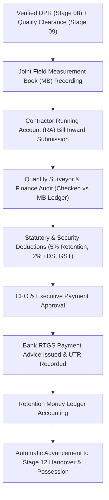

# Stage 11: Finance & Contractor RA Billing Engine

## 1. What is this Stage in Plain English?
Stage 11 manages the project treasury and contractor bill settlement. It converts field measurements recorded in the Measurement Book (MB) into contractor Running Account (RA) bills, applies mandatory statutory deductions (TDS, GST TDS, labor cess), withholds 5% contractor retention money, and routes audited net payouts for executive approval before bank disbursement.

- **Primary System Route**: `/pms/finance`
- **Module Classification**: Stage 11 of 13 in the TaskFlow PMS Governance Rail

---

## 2. Why Real Estate Developers Need This Stage (The Problem It Solves)
Overpaying contractors or paying for unexecuted work is the primary cause of developer bankruptcy. In unmanaged projects, contractors submit inflated invoices that accounts teams blindly pay. Stage 11 requires double-entry proof: zero money is paid unless matched to verified Measurement Books and zero-snag quality certificates.

---

## 3. Core Terminology Explained Simply
To help you explain this stage comfortably to your manager or non-technical team members, here are the essential industry terms used in this stage:

- **Measurement Book (MB)**: The official legal engineering ledger where joint field measurements of executed work are recorded by the developer engineer and contractor representative.

- **Running Account (RA) Bill**: Periodic interim invoices submitted by a contractor claiming payment for progress achieved during a billing cycle (e.g. RA Bill 01, RA Bill 02).

- **Retention Money (Security Deposit)**: A mandatory 5% deduction withheld from every contractor bill, held by the developer for 12 months as security against post-handover defects.

- **Statutory Deductions**: Government-mandated tax withholdings including 1% to 2% TDS under Section 194C, 2% GST TDS, and 1% Building & Other Construction Workers (BOCW) Cess.

---

## 4. Step-by-Step Business Process Walkthrough
This stage runs according to the following chronological business sequence:

### Step 1: Joint Field Measurement
 Developer quantity surveyors and contractor engineers measure physical works and sign the Measurement Book.

### Step 2: RA Bill Inwarding
 The contractor submits their RA invoice detailing claimed quantities against agreed work order unit rates.

### Step 3: Quantity & Quality Reconciliation
 The finance engine validates claimed quantities against the MB ledger and Stage 09 Quality Clearance.

### Step 4: Automated Deductions
 The system automatically withholds 5% retention money, recovers material advances, and calculates TDS and GST withholdings.

### Step 5: CFO & Executive Payment Sanction
 The net payable invoice is audited and approved by the finance controller.

### Step 6: Bank Disbursement & Retention Ledger
 Bank RTGS advice is generated, payment UTR is logged, and retention amounts are credited to the security ledger.

---

## 5. Visual Process Workflow Diagram

---

## 6. Key People & Roles Involved

| Role | Operational Responsibility |
|:---|:---|
| **Quantity Surveyor (QS)** | Measures physical site work and certifies the Measurement Book. |
| **Billing & Finance Accountant** | Audits tax deductions, invoice compliance, and advances. |
| **Chief Financial Officer (CFO)** | Authorizes final treasury release and bank payment advice. |

---

## 7. Dashboard KPI Summary Cards Explained
The top header of the module features 5 high-impact metrics cards. Clicking any card automatically filters the records table below:

| Card # | Metric Title | What It Measures | Filter Key Trigger |
|:---|:---|:---|:---|
| **1** | **Tracked Ledgers** | Total project financial accounts under active governance | `all` |
| **2** | **Gross Disbursed** | Cumulative contractor payouts cleared and paid | `hasOutflow` |
| **3** | **Pending Clearances** | Approved RA bills pending treasury disbursement | `pendingClearance` |
| **4** | **Certified & Settled** | Projects with audited contractor bill closures | `approved` |
| **5** | **Contractor RA Billings** | Total running account bill value certified to date | `hasRaBills` |

---

## 8. Stage Gate & Checklist Automation Criteria
To ensure complete governance, this stage cannot be marked complete until the following rules are satisfied:
1. **100% Mandatory Fields Completed**: All section forms must be populated and verified.
2. **Document Attachments Uploaded**: Key verification documents and photos must be uploaded.
3. **Authorized Officer Sign-off**: Digital verification stamps are saved in the immutable `statusHistory` log.
4. **Automatic Project Rail Advancement**: Once approved, the master project state automatically advances to the next stage on the project header rail.

---

## 9. 60-Second Presentation Pitch for Your Manager
> *"**Stage 11 is our financial fortress. Not a single rupee is paid to contractors without joint measurement book entries, quality clearances, statutory tax deductions, and a 5% safety retention hold.**"*
