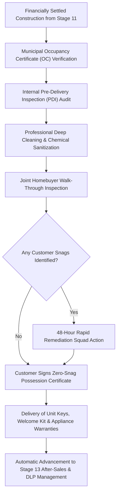

# Stage 12: Handover & Customer Possession Management

## 1. What is this Stage in Plain English?
Stage 12 orchestrates the grand finale of construction: transitioning completed properties to excited homebuyers. It verifies statutory municipal Occupancy Certificates (OC), conducts professional deep cleaning, facilitates a joint walk-through inspection with the buyer, achieves zero-snag customer sign-off, and delivers keys with a branded welcome kit and possession documentation.

- **Primary System Route**: `/pms/handover`
- **Module Classification**: Stage 12 of 13 in the TaskFlow PMS Governance Rail

---

## 2. Why Real Estate Developers Need This Stage (The Problem It Solves)
Handing over dirty, poorly finished units with leaky faucets or cosmetic scratches causes furious customer disputes, withheld final payments, and viral social media complaints. Stage 12 enforces a rigorous pre-delivery inspection (PDI) and customer joint walk-through to ensure every home is delivered in pristine condition.

---

## 3. Core Terminology Explained Simply
To help you explain this stage comfortably to your manager or non-technical team members, here are the essential industry terms used in this stage:

- **Occupancy Certificate (OC)**: The municipal government certificate declaring that the building was constructed in full compliance with sanctioned plans and is safe for human habitation.

- **Pre-Delivery Inspection (PDI)**: An internal exhaustive inspection of every door, window, electrical outlet, and plumbing fixture before inviting the customer.

- **Deep Cleaning Certification**: Professional scrubbing of floors, polishing of glass panes, sanitization of bathrooms, and pest control treatment.

- **Possession Letter & Welcome Kit**: The formal legal document transferring physical custody, accompanied by unit keys, appliance warranty cards, and resident club manuals.

---

## 4. Step-by-Step Business Process Walkthrough
This stage runs according to the following chronological business sequence:

### Step 1: Statutory Clearance Verification
 Confirming municipal Occupancy Certificate, fire safety NOC, and electrical inspector approvals.

### Step 2: Internal Pre-Delivery Inspection (PDI)
 Developer engineers audit finishes, paint sheen, tile leveling, and MEP functions.

### Step 3: Professional Deep Cleaning
 Specialized cleaning teams polish glass, scrub tiles, and sanitize the premises.

### Step 4: Joint Customer Walk-Through
 The buyer and customer relations executive walk the home together with a digital checklist.

### Step 5: Immediate Touch-Up Rectification
 Any minor cosmetic concerns raised by the buyer are resolved within 48 hours by rapid-response teams.

### Step 6: Key Handover & Document Execution
 The buyer signs the Zero-Snag Possession Certificate and receives keys, welcome gifts, and utility meter readings.

---

## 5. Visual Process Workflow Diagram

---

## 6. Key People & Roles Involved

| Role | Operational Responsibility |
|:---|:---|
| **Customer Relations Manager (CRM)** | Welcomes homebuyers and facilitates joint possession walk-throughs. |
| **Handover Quality Lead** | Performs pre-delivery inspection and oversees deep cleaning. |
| **Facility Caretaker** | Records final electricity and water meter readings and delivers key sets. |

---

## 7. Dashboard KPI Summary Cards Explained
The top header of the module features 5 high-impact metrics cards. Clicking any card automatically filters the records table below:

| Card # | Metric Title | What It Measures | Filter Key Trigger |
|:---|:---|:---|:---|
| **1** | **Total Registers** | Total property handover registers under management | `all` |
| **2** | **Possession Delivered** | Units officially handed over with keys and documentation | `possessionCompleted` |
| **3** | **Zero-Snag Verified** | Units certified defect-free by homeowner inspection | `zeroSnagVerified` |
| **4** | **Pending Snags Backlog** | Units undergoing minor cosmetic touch-up remediation | `hasPendingSnags` |
| **5** | **Final Inspections Cleared** | Units with structural and MEP safety clearances issued | `inspectionsCleared` |

---

## 8. Stage Gate & Checklist Automation Criteria
To ensure complete governance, this stage cannot be marked complete until the following rules are satisfied:
1. **100% Mandatory Fields Completed**: All section forms must be populated and verified.
2. **Document Attachments Uploaded**: Key verification documents and photos must be uploaded.
3. **Authorized Officer Sign-off**: Digital verification stamps are saved in the immutable `statusHistory` log.
4. **Automatic Project Rail Advancement**: Once approved, the master project state automatically advances to the next stage on the project header rail.

---

## 9. 60-Second Presentation Pitch for Your Manager
> *"**Stage 12 guarantees delight at move-in. We deep clean every unit, conduct a joint walk-through with the customer, eliminate 100% of snags, and document flawless possession transfer.**"*
