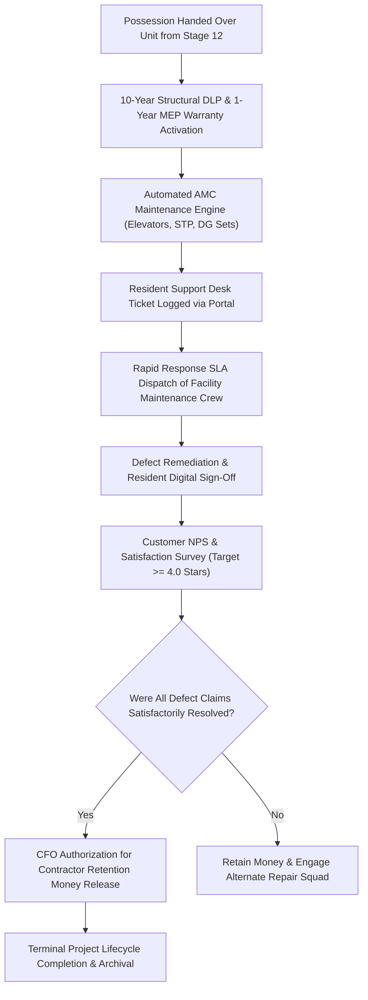

# Stage 13: After-Sales Warranty & DLP Management

## 1. What is this Stage in Plain English?
Stage 13 manages the long-term post-handover lifecycle. It governs the 10-year structural defect liability (DLP), 1-year MEP warranty claims, quarterly preventive Annual Maintenance Contracts (AMC) for community infrastructure (elevators, STP, generators), resident support desk tickets, and customer Net Promoter Score (NPS) tracking.

- **Primary System Route**: `/pms/after-sales`
- **Module Classification**: Stage 13 of 13 in the TaskFlow PMS Governance Rail

---

## 2. Why Real Estate Developers Need This Stage (The Problem It Solves)
Developers often abandon communities after handing over keys. When lifts malfunction, STPs fail, or water pumps break, residents turn hostile, leading to RERA consumer court lawsuits and severe brand damage. Stage 13 provides structured maintenance and uses contractor retention money to enforce repairs.

---

## 3. Core Terminology Explained Simply
To help you explain this stage comfortably to your manager or non-technical team members, here are the essential industry terms used in this stage:

- **Defect Liability Period (DLP)**: The statutory post-handover period (typically 5 to 10 years for structural, 1 year for MEP) during which the developer must fix construction defects without cost to the buyer.

- **Annual Maintenance Contract (AMC)**: Contractual preventive maintenance agreements with specialist vendors for shared community machinery (elevators, backup generators, water treatment).

- **Punch-List / Warranty Ticket**: A service request raised by a resident for post-occupancy defects (e.g. plumbing leak, lock malfunction).

- **Retention Release Audit**: The final accounting sign-off releasing the 5% contractor retention money only after the contractor fulfills all DLP repair obligations.

---

## 4. Step-by-Step Business Process Walkthrough
This stage runs according to the following chronological business sequence:

### Step 1: Warranty Activation
 Upon possession, the unit warranty policies (10-year structural, 1-year MEP) are activated in the resident portal.

### Step 2: Preventive AMC Scheduling
 The system generates automated quarterly service calendars for community infrastructure (STP, generators, lifts).

### Step 3: Resident Helpdesk Tickets
 Residents log complaints via the portal with photos; tickets are auto-assigned to on-site technicians with SLA timers.

### Step 4: Defect Remediation
 Facility technicians or original sub-contractors execute repairs, followed by digital resident sign-off.

### Step 5: Customer Satisfaction & NPS
 Annual satisfaction surveys evaluate resident sentiment (targeting scores >= 4.0 out of 5.0).

### Step 6: Contractor Retention Money Release
 At the end of the defect liability term, contractor retention money is released only if all warranty claims were resolved.

---

## 5. Visual Process Workflow Diagram

---

## 6. Key People & Roles Involved

| Role | Operational Responsibility |
|:---|:---|
| **Facility Maintenance Lead** | Dispatches technicians and ensures SLA ticket resolution. |
| **AMC Operations Coordinator** | Schedules servicing for elevators, transformers, and STPs. |
| **Customer Experience Officer** | Tracks homeowner satisfaction scores and NPS feedback. |

---

## 7. Dashboard KPI Summary Cards Explained
The top header of the module features 5 high-impact metrics cards. Clicking any card automatically filters the records table below:

| Card # | Metric Title | What It Measures | Filter Key Trigger |
|:---|:---|:---|:---|
| **1** | **Total Portfolios** | Projects under active warranty and lifetime facility support | `all` |
| **2** | **Active Warranty Claims** | Open resident punch-list and defect remediation tickets | `hasActiveClaims` |
| **3** | **AMC Visits Executed** | Completed preventive maintenance cycles for shared infrastructure | `amcCompleted` |
| **4** | **Support Queries Resolved** | Resident helpdesk tickets successfully resolved and closed | `supportResolved` |
| **5** | **Customer Satisfaction** | Top rated customer satisfaction score (>= 4.0 / 5.0) | `topRated` |

---

## 8. Stage Gate & Checklist Automation Criteria
To ensure complete governance, this stage cannot be marked complete until the following rules are satisfied:
1. **100% Mandatory Fields Completed**: All section forms must be populated and verified.
2. **Document Attachments Uploaded**: Key verification documents and photos must be uploaded.
3. **Authorized Officer Sign-off**: Digital verification stamps are saved in the immutable `statusHistory` log.
4. **Automatic Project Rail Advancement**: Once approved, the master project state automatically advances to the next stage on the project header rail.

---

## 9. 60-Second Presentation Pitch for Your Manager
> *"**Stage 13 builds our brand for life. We honor 10-year structural defect warranties, run preventive AMC maintenance on common infrastructure, and resolve resident tickets swiftly while holding contractor retention money as security.**"*
