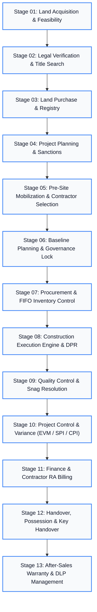
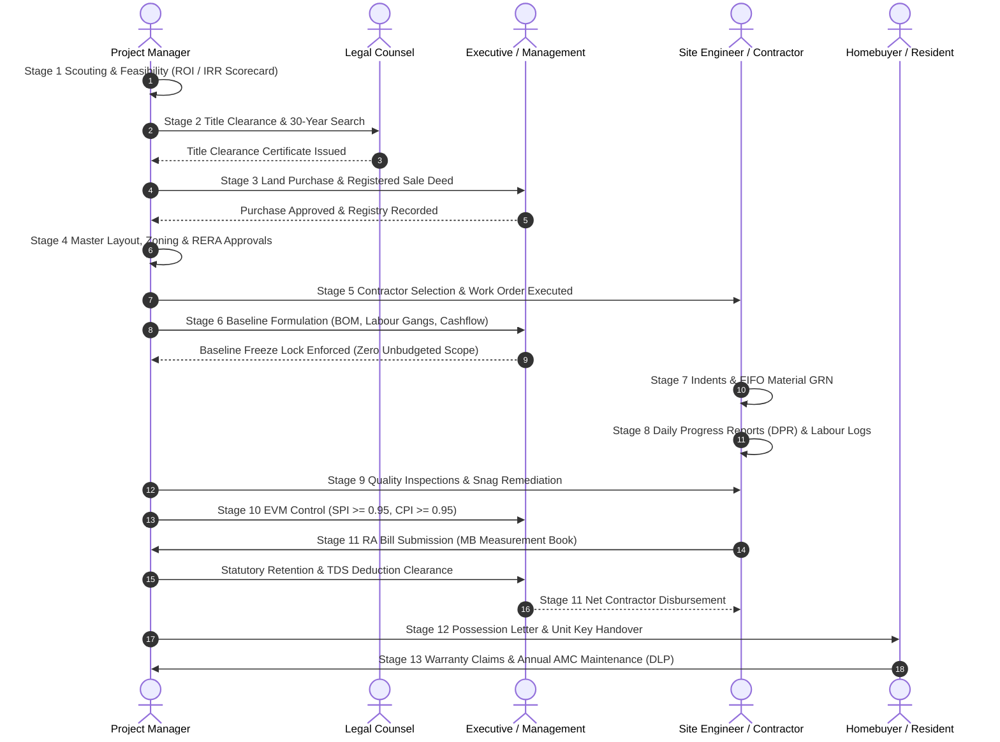

# Project Management System (PMS) — Master Architecture & Flow Guide

## Executive Overview
The **TaskFlow PMS Engine** is an enterprise-grade, 13-stage real estate and infrastructure lifecycle management platform. It governs real estate development projects from raw land scouting and feasibility studies through legal clearance, financial modeling, baseline governance, procurement, construction execution, quality snags, cost accounting, handover, and 10-year defect liability (DLP) warranty tracking.

Each project strictly follows a **single-direction governance rail** where stages cannot advance until mandatory checklists, quantitative validations, and executive approvals are fulfilled.

---

## PMS 13-Stage Master Lifecycle Flow

---

## Cross-Stage Governance & Baseline Enforcement Sequence

---

## 13-Stage Comprehensive Reference Table

| Stage # | Stage Name | Primary URL Route | Mongoose Model | Key Deliverables & Approval Gate |
|:---|:---|:---|:---|:---|
| **01** | Land Acquisition & Feasibility | `/pms/plots` | `Plot`, `Feasibility` | Title scoring, GPS coordinates, financial IRR & ROI feasibility |
| **02** | Legal Verification | `/pms/legal-cases` | `PmsLegalCase` | 30-year search, encumbrance check, advocate clearance opinion |
| **03** | Land Purchase & Registry | `/pms/land-purchases` | `LandPurchase` | Sale deed, stamp duty payment, mutation record, Sub-Registrar seal |
| **04** | Project Planning & Sanctions | `/pms/planning` | `ProjectPlanning` | Master layout, road/drainage design, amenity plan, civil budget |
| **05** | Pre-Site Mobilization | `/pms/pre-site` | `PreSiteStart` | Contractor vetting, item rate card, work order, site water/power |
| **06** | Baseline Planning & Lock | `/pms/baseline` | `BaselinePlanning` | BOM material matrix, labor gangs, timeline milestones, baseline freeze |
| **07** | Procurement & FIFO Stock | `/pms/procurement` | `ProcurementInventory` | Purchase orders, GRN inspection, FIFO inventory issue, batch stock |
| **08** | Construction Execution Engine | `/pms/construction` | `ConstructionExecution` | Daily Progress Reports (DPR), labor muster roll, milestone tracking |
| **09** | Quality Control & Snag Lists | `/pms/quality` | `QualityControl` | Cube test results, MEP inspection, snag tracking, 100% de-snag clearance |
| **10** | Project Control & Variance | `/pms/project-control` | `ProjectControl` | Earned Value Management (EVM), Cost Variance (CV), Schedule Variance (SV) |
| **11** | Finance & RA Billing | `/pms/finance` | `PmsFinance` | Measurement Book (MB), contractor RA bills, retention money, GST/TDS |
| **12** | Handover & Possession | `/pms/handover` | `PmsHandover` | Completion certificate, deep cleaning, zero-snag buyer sign-off, key kit |
| **13** | After-Sales & DLP Warranty | `/pms/after-sales` | `PmsAfterSales` | 10-year defect liability, punch-list tickets, AMC schedules, NPS rating |

---

## Core System Architecture Principles

1. **Strict Stage Gating**: A project cannot transition to Stage `N+1` until Stage `N` has all sections marked `completed` and management sign-off is logged in the immutable `statusHistory` audit log.
2. **Double-Entry Financial Integrity**: No contractor invoice can be cleared in Stage 11 without verified Measurement Book entries from Stage 8 Construction and Stage 9 Quality approvals.
3. **FIFO Stock Accounting**: Materials issued to site contractors draw strictly from the oldest unexhausted Good Receipt Notes (GRN) to ensure precise landed cost valuation.
4. **Baseline Lock Governance**: Once Stage 06 Baseline is locked, any deviation requires formal Change Order Requests logged under Stage 10 Variance Control.
5. **Contextual Real-Time UI**: Every module features 5 high-impact KPI summary cards, interactive filter triggers, active ring highlights, and explicit entity pagination counts.
