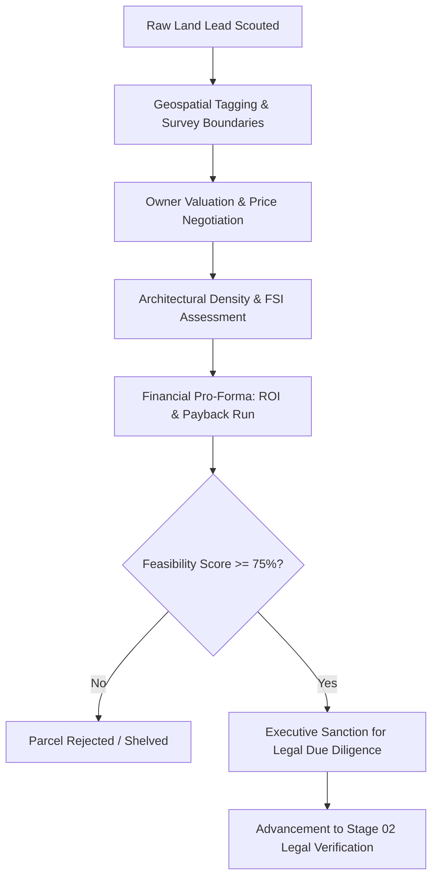

# Stage 01: Land Acquisition & Feasibility Study

## 1. Executive Summary & Business Objective
Identifies raw land parcels, logs geospatial telemetry, records owner expectations, and conducts rigorous financial and architectural feasibility analysis.

This stage constitutes **Stage 01** of the 13-stage PMS lifecycle. It enforces standard operating procedures, quantitative data validation, and approval checks to ensure complete governance before downstream project stages can proceed.

- **Primary Route**: `/pms/plots`
- **Mongoose Model**: `Plot, Feasibility`

---

## 2. Stage Workflow & Decision Tree

---

## 3. Top 5 KPI Header Cards & Filter Behaviors
Each card displays key live metrics, interactive hover tooltips `(i)`, active ring highlight styling, and triggers table filtering upon clicking.

| Card # | KPI Title | Data Source / Calculation | Filter State Trigger |
|:---|:---|:---|:---|
| **1** | **Total Plots** | Total scouted parcels registered in database | `all` |
| **2** | **Under Visit / Analysis** | Parcels undergoing initial site topography inspection | `visitScheduled` |
| **3** | **Feasibility Complete** | Plots with calculated IRR and civil viability scores | `underAnalysis` |
| **4** | **Approved for Purchase** | Management cleared plots ready for legal audit | `approved` |
| **5** | **Total Scouted Acreage** | Cumulative land area scouted across regions | `acreage` |

---

## 4. Section-by-Section Workflow & Data Breakdown
The module contains 5 structured functional sections. Each section must be completed and marked verified to enable stage advancement.

### Section 1: Basic Plot Information (survey number, boundaries, location, landowner details)
- **Objective**: Capture and validate all required operational data for basic plot information (survey number, boundaries, location, landowner details).
- **Data Attributes**: Validated schema fields, attachments, timestamps, and officer IDs.
- **Completion Check**: Requires 100% mandatory fields populated and verified.

### Section 2: Site Visit & Soil Survey (topography, access roads, water table, electrical proximity)
- **Objective**: Capture and validate all required operational data for site visit & soil survey (topography, access roads, water table, electrical proximity).
- **Data Attributes**: Validated schema fields, attachments, timestamps, and officer IDs.
- **Completion Check**: Requires 100% mandatory fields populated and verified.

### Section 3: Zoning & Regulatory Screening (master plan category, green belt, setback limits)
- **Objective**: Capture and validate all required operational data for zoning & regulatory screening (master plan category, green belt, setback limits).
- **Data Attributes**: Validated schema fields, attachments, timestamps, and officer IDs.
- **Completion Check**: Requires 100% mandatory fields populated and verified.

### Section 4: Financial Viability Study (FSI, estimated sale realization, expected IRR/ROI)
- **Objective**: Capture and validate all required operational data for financial viability study (fsi, estimated sale realization, expected irr/roi).
- **Data Attributes**: Validated schema fields, attachments, timestamps, and officer IDs.
- **Completion Check**: Requires 100% mandatory fields populated and verified.

### Section 5: Executive Approval Gate (investment committee sign-off to initiate legal clearance)
- **Objective**: Capture and validate all required operational data for executive approval gate (investment committee sign-off to initiate legal clearance).
- **Data Attributes**: Validated schema fields, attachments, timestamps, and officer IDs.
- **Completion Check**: Requires 100% mandatory fields populated and verified.

---

## 5. Stage Progression & Checklist Automation Rules
- **Automatic Gating**: When all 5 section checklists are marked `done`, the document status automatically updates to `approved`.
- **Audit History**: Every transition creates an immutable record in `statusHistory` with user ID, previous status, next status, and timestamp.
- **Downstream Advancement**: Approving this stage automatically spawns or unlocks the subsequent stage on the project's master stage rail.

---

## 6. Manager Presentation Talking Points
- **Prevents capital lock-in by enforcing scientific feasibility scoring before any land token is paid.**
- **Stores geofenced plot boundaries and survey numbers to eliminate overlap disputes.**
- **Automatically generates Stage 02 Legal Verification records upon investment committee approval.**
