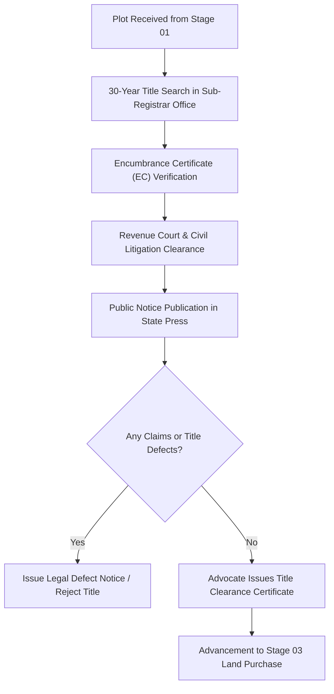

# Stage 02: Legal Verification & Title Due Diligence

## 1. Executive Summary & Business Objective
Conducts 30-year title trail searches, verifies encumbrance certificates, checks revenue court disputes, and secures written legal opinions from empaneled advocates.

This stage constitutes **Stage 02** of the 13-stage PMS lifecycle. It enforces standard operating procedures, quantitative data validation, and approval checks to ensure complete governance before downstream project stages can proceed.

- **Primary Route**: `/pms/legal-cases`
- **Mongoose Model**: `PmsLegalCase`

---

## 2. Stage Workflow & Decision Tree

---

## 3. Top 5 KPI Header Cards & Filter Behaviors
Each card displays key live metrics, interactive hover tooltips `(i)`, active ring highlight styling, and triggers table filtering upon clicking.

| Card # | KPI Title | Data Source / Calculation | Filter State Trigger |
|:---|:---|:---|:---|
| **1** | **Total Legal Cases** | All active legal audit records | `all` |
| **2** | **Under Search** | Cases undergoing Sub-Registrar records lookup | `underSearch` |
| **3** | **Public Notice Active** | Newspaper publication running 14-day claim window | `noticeActive` |
| **4** | **Title Clear** | Advocate certified parcels free from encumbrance | `titleClear` |
| **5** | **High Risk / Litigation** | Parcels flagged with active litigation or boundary issues | `litigationFlagged` |

---

## 4. Section-by-Section Workflow & Data Breakdown
The module contains 5 structured functional sections. Each section must be completed and marked verified to enable stage advancement.

### Section 1: Title Chain Audit (minimum 30 years unbroken sequence of title deeds)
- **Objective**: Capture and validate all required operational data for title chain audit (minimum 30 years unbroken sequence of title deeds).
- **Data Attributes**: Validated schema fields, attachments, timestamps, and officer IDs.
- **Completion Check**: Requires 100% mandatory fields populated and verified.

### Section 2: Encumbrance Verification (Form 15 & Form 16 check from registration authorities)
- **Objective**: Capture and validate all required operational data for encumbrance verification (form 15 & form 16 check from registration authorities).
- **Data Attributes**: Validated schema fields, attachments, timestamps, and officer IDs.
- **Completion Check**: Requires 100% mandatory fields populated and verified.

### Section 3: Litigation & Revenue Check (District collector records, land acquisition notices)
- **Objective**: Capture and validate all required operational data for litigation & revenue check (district collector records, land acquisition notices).
- **Data Attributes**: Validated schema fields, attachments, timestamps, and officer IDs.
- **Completion Check**: Requires 100% mandatory fields populated and verified.

### Section 4: Public Notice Period (tracking statutory objection window in daily newspapers)
- **Objective**: Capture and validate all required operational data for public notice period (tracking statutory objection window in daily newspapers).
- **Data Attributes**: Validated schema fields, attachments, timestamps, and officer IDs.
- **Completion Check**: Requires 100% mandatory fields populated and verified.

### Section 5: Final Title Clearance Opinion (formal sign-off by legal counsel)
- **Objective**: Capture and validate all required operational data for final title clearance opinion (formal sign-off by legal counsel).
- **Data Attributes**: Validated schema fields, attachments, timestamps, and officer IDs.
- **Completion Check**: Requires 100% mandatory fields populated and verified.

---

## 5. Stage Progression & Checklist Automation Rules
- **Automatic Gating**: When all 5 section checklists are marked `done`, the document status automatically updates to `approved`.
- **Audit History**: Every transition creates an immutable record in `statusHistory` with user ID, previous status, next status, and timestamp.
- **Downstream Advancement**: Approving this stage automatically spawns or unlocks the subsequent stage on the project's master stage rail.

---

## 6. Manager Presentation Talking Points
- **Guarantees zero litigation risk before multi-crore land investments are disbursed.**
- **Tracks statutory 14-day notice periods with timestamped newspaper clipping uploads.**
- **Strict legal clearance certificate required before Stage 03 land purchase contracts can be generated.**
