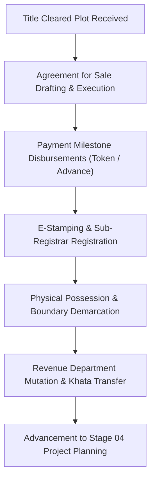

# Stage 03: Land Purchase & Sub-Registrar Registry

## 1. Executive Summary & Business Objective
Governs sale agreements, stamp duty payments, token payments, official registration at the Sub-Registrar office, and land revenue mutation.

This stage constitutes **Stage 03** of the 13-stage PMS lifecycle. It enforces standard operating procedures, quantitative data validation, and approval checks to ensure complete governance before downstream project stages can proceed.

- **Primary Route**: `/pms/land-purchases`
- **Mongoose Model**: `LandPurchase`

---

## 2. Stage Workflow & Decision Tree

---

## 3. Top 5 KPI Header Cards & Filter Behaviors
Each card displays key live metrics, interactive hover tooltips `(i)`, active ring highlight styling, and triggers table filtering upon clicking.

| Card # | KPI Title | Data Source / Calculation | Filter State Trigger |
|:---|:---|:---|:---|
| **1** | **Total Land Purchases** | Total purchase transactions recorded | `all` |
| **2** | **Agreement Phase** | Deals with executed agreement to sell | `agreementPhase` |
| **3** | **Registration Scheduled** | Awaiting appointment at Sub-Registrar office | `registrationScheduled` |
| **4** | **Registered & Mutated** | Fully registered with updated revenue records | `registered` |
| **5** | **Total Land Capital Deployed** | Cumulative capital invested in land acquisition | `capital` |

---

## 4. Section-by-Section Workflow & Data Breakdown
The module contains 5 structured functional sections. Each section must be completed and marked verified to enable stage advancement.

### Section 1: Agreement for Sale (clauses, consideration amount, scheduled milestones)
- **Objective**: Capture and validate all required operational data for agreement for sale (clauses, consideration amount, scheduled milestones).
- **Data Attributes**: Validated schema fields, attachments, timestamps, and officer IDs.
- **Completion Check**: Requires 100% mandatory fields populated and verified.

### Section 2: Payment Milestones (token, earnest money, balance consideration, TDS u/s 194-IA)
- **Objective**: Capture and validate all required operational data for payment milestones (token, earnest money, balance consideration, tds u/s 194-ia).
- **Data Attributes**: Validated schema fields, attachments, timestamps, and officer IDs.
- **Completion Check**: Requires 100% mandatory fields populated and verified.

### Section 3: Registration Details (Sub-Registrar office, book number, volume, document number)
- **Objective**: Capture and validate all required operational data for registration details (sub-registrar office, book number, volume, document number).
- **Data Attributes**: Validated schema fields, attachments, timestamps, and officer IDs.
- **Completion Check**: Requires 100% mandatory fields populated and verified.

### Section 4: Physical Possession & Demarcation (boundary pillar erection, fence handover)
- **Objective**: Capture and validate all required operational data for physical possession & demarcation (boundary pillar erection, fence handover).
- **Data Attributes**: Validated schema fields, attachments, timestamps, and officer IDs.
- **Completion Check**: Requires 100% mandatory fields populated and verified.

### Section 5: Revenue Mutation / Khata Transfer (tehsildar order, updated 7/12 or RTC extract)
- **Objective**: Capture and validate all required operational data for revenue mutation / khata transfer (tehsildar order, updated 7/12 or rtc extract).
- **Data Attributes**: Validated schema fields, attachments, timestamps, and officer IDs.
- **Completion Check**: Requires 100% mandatory fields populated and verified.

---

## 5. Stage Progression & Checklist Automation Rules
- **Automatic Gating**: When all 5 section checklists are marked `done`, the document status automatically updates to `approved`.
- **Audit History**: Every transition creates an immutable record in `statusHistory` with user ID, previous status, next status, and timestamp.
- **Downstream Advancement**: Approving this stage automatically spawns or unlocks the subsequent stage on the project's master stage rail.

---

## 6. Manager Presentation Talking Points
- **Provides complete capital tracking with automatic 1% TDS deduction safeguards.**
- **Eliminates title leakage by mandating post-registration mutation before project launch.**
- **Automatically spawns the master project record in Stage 04 upon completed mutation.**
