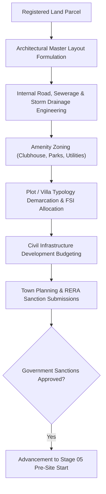

# Stage 04: Project Planning & Statutory Sanctions

## 1. Executive Summary & Business Objective
Orchestrates architectural master layouts, internal road/drainage design, amenity typologies, civil development cost estimates, and RERA/Govt sanctions.

This stage constitutes **Stage 04** of the 13-stage PMS lifecycle. It enforces standard operating procedures, quantitative data validation, and approval checks to ensure complete governance before downstream project stages can proceed.

- **Primary Route**: `/pms/planning`
- **Mongoose Model**: `ProjectPlanning`

---

## 2. Stage Workflow & Decision Tree

---

## 3. Top 5 KPI Header Cards & Filter Behaviors
Each card displays key live metrics, interactive hover tooltips `(i)`, active ring highlight styling, and triggers table filtering upon clicking.

| Card # | KPI Title | Data Source / Calculation | Filter State Trigger |
|:---|:---|:---|:---|
| **1** | **Total Plans** | Total registered project planning & design master records | `all` |
| **2** | **In Planning** | Projects actively progressing through design stages | `inPlanning` |
| **3** | **Awaiting Sanction** | Completed designs pending management or municipal sanction | `managementApproval` |
| **4** | **Approved Plans** | Fully sanctioned plans cleared for contractor selection | `approved` |
| **5** | **Total Dev Budget** | Cumulative estimated civil infrastructure development budget | `hasBudget` |

---

## 4. Section-by-Section Workflow & Data Breakdown
The module contains 5 structured functional sections. Each section must be completed and marked verified to enable stage advancement.

### Section 1: Master Layout & Survey Boundary (architectural blueprints, green zones)
- **Objective**: Capture and validate all required operational data for master layout & survey boundary (architectural blueprints, green zones).
- **Data Attributes**: Validated schema fields, attachments, timestamps, and officer IDs.
- **Completion Check**: Requires 100% mandatory fields populated and verified.

### Section 2: Roads, Stormwater & Utility Networks (road width, grading, drain culverts)
- **Objective**: Capture and validate all required operational data for roads, stormwater & utility networks (road width, grading, drain culverts).
- **Data Attributes**: Validated schema fields, attachments, timestamps, and officer IDs.
- **Completion Check**: Requires 100% mandatory fields populated and verified.

### Section 3: Amenity Planning (clubhouse, swimming pool, parks, STP, electrical substation)
- **Objective**: Capture and validate all required operational data for amenity planning (clubhouse, swimming pool, parks, stp, electrical substation).
- **Data Attributes**: Validated schema fields, attachments, timestamps, and officer IDs.
- **Completion Check**: Requires 100% mandatory fields populated and verified.

### Section 4: Plot / Villa Typology Breakdown (unit sizes, facing, classification)
- **Objective**: Capture and validate all required operational data for plot / villa typology breakdown (unit sizes, facing, classification).
- **Data Attributes**: Validated schema fields, attachments, timestamps, and officer IDs.
- **Completion Check**: Requires 100% mandatory fields populated and verified.

### Section 5: Development Budget & Approvals (itemized BOQ estimates, RERA clearance)
- **Objective**: Capture and validate all required operational data for development budget & approvals (itemized boq estimates, rera clearance).
- **Data Attributes**: Validated schema fields, attachments, timestamps, and officer IDs.
- **Completion Check**: Requires 100% mandatory fields populated and verified.

---

## 5. Stage Progression & Checklist Automation Rules
- **Automatic Gating**: When all 5 section checklists are marked `done`, the document status automatically updates to `approved`.
- **Audit History**: Every transition creates an immutable record in `statusHistory` with user ID, previous status, next status, and timestamp.
- **Downstream Advancement**: Approving this stage automatically spawns or unlocks the subsequent stage on the project's master stage rail.

---

## 6. Manager Presentation Talking Points
- **Integrates architectural design directly with initial civil cost budgeting.**
- **Validates RERA compliance before permitting any on-site mobilization.**
- **Features clickable Total Dev Budget filter card to isolate high-outlay projects.**
