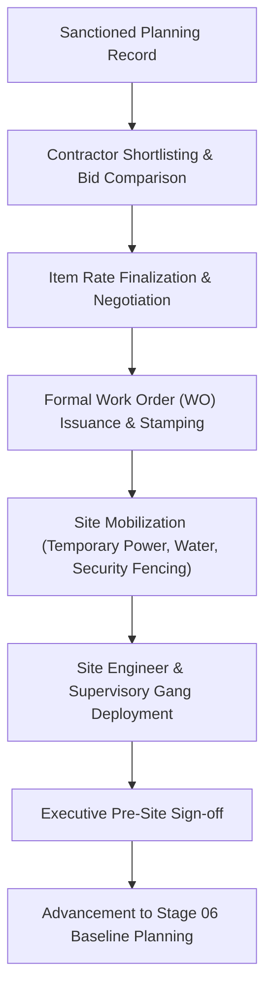

# Stage 05: Pre-Site Mobilization & Contractor Selection

## 1. Executive Summary & Business Objective
Manages contractor shortlisting, competitive unit rate negotiation, formal Work Order (WO) agreements, site boundary fencing, water, power, and site office mobilization.

This stage constitutes **Stage 05** of the 13-stage PMS lifecycle. It enforces standard operating procedures, quantitative data validation, and approval checks to ensure complete governance before downstream project stages can proceed.

- **Primary Route**: `/pms/pre-site`
- **Mongoose Model**: `PreSiteStart`

---

## 2. Stage Workflow & Decision Tree

---

## 3. Top 5 KPI Header Cards & Filter Behaviors
Each card displays key live metrics, interactive hover tooltips `(i)`, active ring highlight styling, and triggers table filtering upon clicking.

| Card # | KPI Title | Data Source / Calculation | Filter State Trigger |
|:---|:---|:---|:---|
| **1** | **Total Workflows** | Total pre-site mobilization workflows registered | `all` |
| **2** | **In Procurement** | Active contractor bidding and rate negotiations | `inPreSite` |
| **3** | **Awaiting Sign-off** | Completed setups awaiting management approval | `managementApproval` |
| **4** | **Mobilized & Approved** | Sites fully mobilized with deployed engineering teams | `approved` |
| **5** | **Total Work Orders** | Cumulative value of executed contractor agreements | `hasWorkOrder` |

---

## 4. Section-by-Section Workflow & Data Breakdown
The module contains 5 structured functional sections. Each section must be completed and marked verified to enable stage advancement.

### Section 1: Contractor Selection (firm details, past performance, technical eligibility)
- **Objective**: Capture and validate all required operational data for contractor selection (firm details, past performance, technical eligibility).
- **Data Attributes**: Validated schema fields, attachments, timestamps, and officer IDs.
- **Completion Check**: Requires 100% mandatory fields populated and verified.

### Section 2: Rate Finalization (unit rates for earthwork, concrete, steel, masonry)
- **Objective**: Capture and validate all required operational data for rate finalization (unit rates for earthwork, concrete, steel, masonry).
- **Data Attributes**: Validated schema fields, attachments, timestamps, and officer IDs.
- **Completion Check**: Requires 100% mandatory fields populated and verified.

### Section 3: Work Order Agreement (scope of work, penalty clauses, defect liability term)
- **Objective**: Capture and validate all required operational data for work order agreement (scope of work, penalty clauses, defect liability term).
- **Data Attributes**: Validated schema fields, attachments, timestamps, and officer IDs.
- **Completion Check**: Requires 100% mandatory fields populated and verified.

### Section 4: Site Setup & Mobilization (temporary electricity, borewell, labour camp, store)
- **Objective**: Capture and validate all required operational data for site setup & mobilization (temporary electricity, borewell, labour camp, store).
- **Data Attributes**: Validated schema fields, attachments, timestamps, and officer IDs.
- **Completion Check**: Requires 100% mandatory fields populated and verified.

### Section 5: Executive Mobilization Sign-off (site ready for baseline freeze)
- **Objective**: Capture and validate all required operational data for executive mobilization sign-off (site ready for baseline freeze).
- **Data Attributes**: Validated schema fields, attachments, timestamps, and officer IDs.
- **Completion Check**: Requires 100% mandatory fields populated and verified.

---

## 5. Stage Progression & Checklist Automation Rules
- **Automatic Gating**: When all 5 section checklists are marked `done`, the document status automatically updates to `approved`.
- **Audit History**: Every transition creates an immutable record in `statusHistory` with user ID, previous status, next status, and timestamp.
- **Downstream Advancement**: Approving this stage automatically spawns or unlocks the subsequent stage on the project's master stage rail.

---

## 6. Manager Presentation Talking Points
- **Enforces formal work orders and safety guidelines before contractors enter the site.**
- **Maintains transparent contractor rate history to optimize future project bidding.**
- **Includes clickable Total Work Orders KPI to track contractor commitments.**
