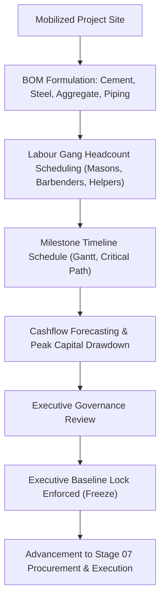

# Stage 06: Baseline Planning & Governance Lock

## 1. Executive Summary & Business Objective
Establishes the immutable baseline master plan: material Bill of Materials (BOM), gang manpower headcounts, milestone delivery timelines, month-by-month cashflow projections, and executive baseline freeze.

This stage constitutes **Stage 06** of the 13-stage PMS lifecycle. It enforces standard operating procedures, quantitative data validation, and approval checks to ensure complete governance before downstream project stages can proceed.

- **Primary Route**: `/pms/baseline`
- **Mongoose Model**: `BaselinePlanning`

---

## 2. Stage Workflow & Decision Tree

---

## 3. Top 5 KPI Header Cards & Filter Behaviors
Each card displays key live metrics, interactive hover tooltips `(i)`, active ring highlight styling, and triggers table filtering upon clicking.

| Card # | KPI Title | Data Source / Calculation | Filter State Trigger |
|:---|:---|:---|:---|
| **1** | **Total Baselines** | Total registered project baseline master plans | `all` |
| **2** | **In Planning** | Formulating BOM, labor gangs, or cashflows | `inPlanning` |
| **3** | **Awaiting Lock** | Complete baselines awaiting executive freeze | `baselineReview` |
| **4** | **Frozen & Locked** | Baselines officially frozen for execution monitoring | `locked` |
| **5** | **Total Baseline Budget** | Cumulative baseline budget allocation across all projects | `hasBudget` |

---

## 4. Section-by-Section Workflow & Data Breakdown
The module contains 5 structured functional sections. Each section must be completed and marked verified to enable stage advancement.

### Section 1: Planned Material BOM (detailed line items, specifications, target rates)
- **Objective**: Capture and validate all required operational data for planned material bom (detailed line items, specifications, target rates).
- **Data Attributes**: Validated schema fields, attachments, timestamps, and officer IDs.
- **Completion Check**: Requires 100% mandatory fields populated and verified.

### Section 2: Planned Labour Headcounts (daily peak/average manpower by trade)
- **Objective**: Capture and validate all required operational data for planned labour headcounts (daily peak/average manpower by trade).
- **Data Attributes**: Validated schema fields, attachments, timestamps, and officer IDs.
- **Completion Check**: Requires 100% mandatory fields populated and verified.

### Section 3: Milestone Timeline Schedule (key completion dates, phase buffers)
- **Objective**: Capture and validate all required operational data for milestone timeline schedule (key completion dates, phase buffers).
- **Data Attributes**: Validated schema fields, attachments, timestamps, and officer IDs.
- **Completion Check**: Requires 100% mandatory fields populated and verified.

### Section 4: Planned Cashflow (monthly anticipated outlays vs revenue realizations)
- **Objective**: Capture and validate all required operational data for planned cashflow (monthly anticipated outlays vs revenue realizations).
- **Data Attributes**: Validated schema fields, attachments, timestamps, and officer IDs.
- **Completion Check**: Requires 100% mandatory fields populated and verified.

### Section 5: Executive Baseline Freeze (digital lock signature preventing unapproved alterations)
- **Objective**: Capture and validate all required operational data for executive baseline freeze (digital lock signature preventing unapproved alterations).
- **Data Attributes**: Validated schema fields, attachments, timestamps, and officer IDs.
- **Completion Check**: Requires 100% mandatory fields populated and verified.

---

## 5. Stage Progression & Checklist Automation Rules
- **Automatic Gating**: When all 5 section checklists are marked `done`, the document status automatically updates to `approved`.
- **Audit History**: Every transition creates an immutable record in `statusHistory` with user ID, previous status, next status, and timestamp.
- **Downstream Advancement**: Approving this stage automatically spawns or unlocks the subsequent stage on the project's master stage rail.

---

## 6. Manager Presentation Talking Points
- **Baseline Lock is the core benchmark against which all future cost & schedule variance is calculated.**
- **Locks both budget and timeline so cost overruns cannot be concealed in later stages.**
- **Clickable Total Baseline Budget card enables instant audit of target capital allocations.**
