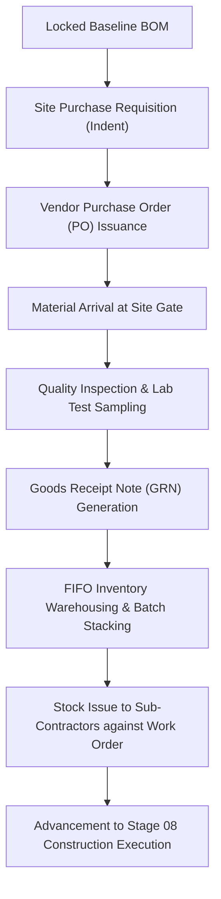

# Stage 07: Procurement & FIFO Inventory Management

## 1. Executive Summary & Business Objective
Controls the site supply chain: vendor purchase orders (PO), Goods Receipt Notes (GRN) with QA inspection, store warehousing, and FIFO stock issue to contractors.

This stage constitutes **Stage 07** of the 13-stage PMS lifecycle. It enforces standard operating procedures, quantitative data validation, and approval checks to ensure complete governance before downstream project stages can proceed.

- **Primary Route**: `/pms/procurement`
- **Mongoose Model**: `ProcurementInventory`

---

## 2. Stage Workflow & Decision Tree

---

## 3. Top 5 KPI Header Cards & Filter Behaviors
Each card displays key live metrics, interactive hover tooltips `(i)`, active ring highlight styling, and triggers table filtering upon clicking.

| Card # | KPI Title | Data Source / Calculation | Filter State Trigger |
|:---|:---|:---|:---|
| **1** | **Total Procurement Records** | All procurement tracking records | `all` |
| **2** | **Active Indents** | Material requisitions currently being processed | `activeIndents` |
| **3** | **PO Dispatched** | Orders placed with vendors awaiting shipment | `poDispatched` |
| **4** | **GRN Inwarded** | Materials received and accepted into store | `grnInwarded` |
| **5** | **Warehouse Stock Value** | Total book value of inventory currently in site store | `stockValue` |

---

## 4. Section-by-Section Workflow & Data Breakdown
The module contains 5 structured functional sections. Each section must be completed and marked verified to enable stage advancement.

### Section 1: Site Requisition / Indent (requested item, required date, site urgency)
- **Objective**: Capture and validate all required operational data for site requisition / indent (requested item, required date, site urgency).
- **Data Attributes**: Validated schema fields, attachments, timestamps, and officer IDs.
- **Completion Check**: Requires 100% mandatory fields populated and verified.

### Section 2: Purchase Order (vendor details, tax terms, delivery schedule, unit rates)
- **Objective**: Capture and validate all required operational data for purchase order (vendor details, tax terms, delivery schedule, unit rates).
- **Data Attributes**: Validated schema fields, attachments, timestamps, and officer IDs.
- **Completion Check**: Requires 100% mandatory fields populated and verified.

### Section 3: Goods Receipt Note (GRN) (weighbridge slips, physical count, damage check)
- **Objective**: Capture and validate all required operational data for goods receipt note (grn) (weighbridge slips, physical count, damage check).
- **Data Attributes**: Validated schema fields, attachments, timestamps, and officer IDs.
- **Completion Check**: Requires 100% mandatory fields populated and verified.

### Section 4: Stock Ledger & FIFO Valuation (batch costing, inventory exhaustion tracking)
- **Objective**: Capture and validate all required operational data for stock ledger & fifo valuation (batch costing, inventory exhaustion tracking).
- **Data Attributes**: Validated schema fields, attachments, timestamps, and officer IDs.
- **Completion Check**: Requires 100% mandatory fields populated and verified.

### Section 5: Contractor Material Issue (site requisition slip, accountable consumption)
- **Objective**: Capture and validate all required operational data for contractor material issue (site requisition slip, accountable consumption).
- **Data Attributes**: Validated schema fields, attachments, timestamps, and officer IDs.
- **Completion Check**: Requires 100% mandatory fields populated and verified.

---

## 5. Stage Progression & Checklist Automation Rules
- **Automatic Gating**: When all 5 section checklists are marked `done`, the document status automatically updates to `approved`.
- **Audit History**: Every transition creates an immutable record in `statusHistory` with user ID, previous status, next status, and timestamp.
- **Downstream Advancement**: Approving this stage automatically spawns or unlocks the subsequent stage on the project's master stage rail.

---

## 6. Manager Presentation Talking Points
- **FIFO material tracking guarantees that project costs reflect true purchase price trends.**
- **Ensures no material is issued without an approved site indent tied to the baseline BOM.**
- **Prevents material theft and ghost inventory by linking GRN gate passes with physical stores.**
