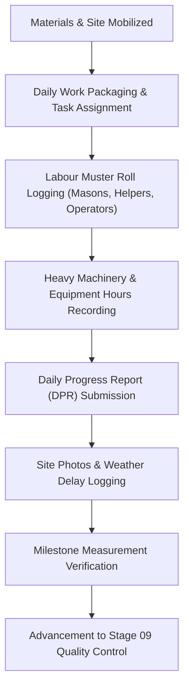

# Stage 08: Construction Execution Engine & DPR

## 1. Executive Summary & Business Objective
Drives on-site field execution: Daily Progress Reports (DPR), daily labor muster rolls, equipment utilization, work package completion, and contractor performance logs.

This stage constitutes **Stage 08** of the 13-stage PMS lifecycle. It enforces standard operating procedures, quantitative data validation, and approval checks to ensure complete governance before downstream project stages can proceed.

- **Primary Route**: `/pms/construction`
- **Mongoose Model**: `ConstructionExecution`

---

## 2. Stage Workflow & Decision Tree

---

## 3. Top 5 KPI Header Cards & Filter Behaviors
Each card displays key live metrics, interactive hover tooltips `(i)`, active ring highlight styling, and triggers table filtering upon clicking.

| Card # | KPI Title | Data Source / Calculation | Filter State Trigger |
|:---|:---|:---|:---|
| **1** | **Active Sites** | Projects under active physical construction | `all` |
| **2** | **DPRs Logged Today** | Daily Progress Reports submitted in the current cycle | `hasDpr` |
| **3** | **On-Site Workforce** | Total labor headcounts deployed across all active sites | `laborHeadcount` |
| **4** | **Milestones Completed** | Civil milestones executed and awaiting quality check | `approved` |
| **5** | **Machinery Operating Hours** | Cumulative heavy equipment operational hours | `machinery` |

---

## 4. Section-by-Section Workflow & Data Breakdown
The module contains 5 structured functional sections. Each section must be completed and marked verified to enable stage advancement.

### Section 1: Daily Progress Report (DPR) (activities completed, cubic meters cast, linear meters paved)
- **Objective**: Capture and validate all required operational data for daily progress report (dpr) (activities completed, cubic meters cast, linear meters paved).
- **Data Attributes**: Validated schema fields, attachments, timestamps, and officer IDs.
- **Completion Check**: Requires 100% mandatory fields populated and verified.

### Section 2: Labor Muster Roll (contractor gangs, skilled vs unskilled ratios, attendance)
- **Objective**: Capture and validate all required operational data for labor muster roll (contractor gangs, skilled vs unskilled ratios, attendance).
- **Data Attributes**: Validated schema fields, attachments, timestamps, and officer IDs.
- **Completion Check**: Requires 100% mandatory fields populated and verified.

### Section 3: Plant & Machinery Log (concrete batching plant, transit mixers, JCB hours)
- **Objective**: Capture and validate all required operational data for plant & machinery log (concrete batching plant, transit mixers, jcb hours).
- **Data Attributes**: Validated schema fields, attachments, timestamps, and officer IDs.
- **Completion Check**: Requires 100% mandatory fields populated and verified.

### Section 4: Site Environmental & Safety Diary (weather conditions, toolbox talks, PPE audit)
- **Objective**: Capture and validate all required operational data for site environmental & safety diary (weather conditions, toolbox talks, ppe audit).
- **Data Attributes**: Validated schema fields, attachments, timestamps, and officer IDs.
- **Completion Check**: Requires 100% mandatory fields populated and verified.

### Section 5: Supervisor Review & Work Package Sign-off (site engineer certification)
- **Objective**: Capture and validate all required operational data for supervisor review & work package sign-off (site engineer certification).
- **Data Attributes**: Validated schema fields, attachments, timestamps, and officer IDs.
- **Completion Check**: Requires 100% mandatory fields populated and verified.

---

## 5. Stage Progression & Checklist Automation Rules
- **Automatic Gating**: When all 5 section checklists are marked `done`, the document status automatically updates to `approved`.
- **Audit History**: Every transition creates an immutable record in `statusHistory` with user ID, previous status, next status, and timestamp.
- **Downstream Advancement**: Approving this stage automatically spawns or unlocks the subsequent stage on the project's master stage rail.

---

## 6. Manager Presentation Talking Points
- **Provides daily operational transparency directly from the construction front line.**
- **Eliminates billing fraud by corroborating contractor claims against daily muster rolls.**
- **Pagination displays exact "construction execution logs" for clear record auditing.**
