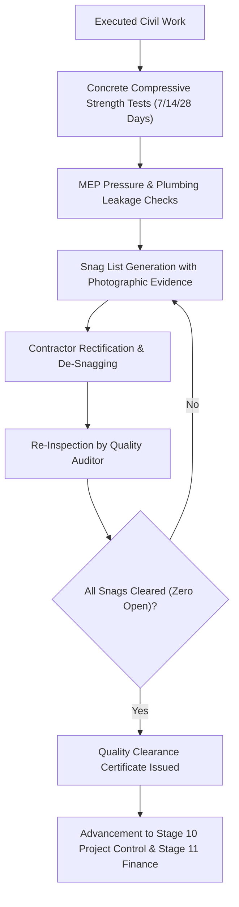

# Stage 09: Quality Control & Snag Remediation

## 1. Executive Summary & Business Objective
Enforces strict civil engineering quality standards: concrete cube crushing strength tests, MEP line tests, snag list generation, and 100% de-snag clearance certification.

This stage constitutes **Stage 09** of the 13-stage PMS lifecycle. It enforces standard operating procedures, quantitative data validation, and approval checks to ensure complete governance before downstream project stages can proceed.

- **Primary Route**: `/pms/quality`
- **Mongoose Model**: `QualityControl`

---

## 2. Stage Workflow & Decision Tree

---

## 3. Top 5 KPI Header Cards & Filter Behaviors
Each card displays key live metrics, interactive hover tooltips `(i)`, active ring highlight styling, and triggers table filtering upon clicking.

| Card # | KPI Title | Data Source / Calculation | Filter State Trigger |
|:---|:---|:---|:---|
| **1** | **Quality Audits** | Total quality control and snagging audit records | `all` |
| **2** | **Inspections in Progress** | Active field audits undergoing verification | `inProgress` |
| **3** | **Open Snags** | Identified defects currently under contractor remediation | `hasOpenSnags` |
| **4** | **Certified Zero-Snag** | Audits with 100% defects cleared and certified | `approved` |
| **5** | **Total Tests Cleared** | Cumulative lab tests passed (slump, cube, rebar) | `hasInspections` |

---

## 4. Section-by-Section Workflow & Data Breakdown
The module contains 5 structured functional sections. Each section must be completed and marked verified to enable stage advancement.

### Section 1: Civil Lab Testing (concrete cube compressive strength, slump test, silt content)
- **Objective**: Capture and validate all required operational data for civil lab testing (concrete cube compressive strength, slump test, silt content).
- **Data Attributes**: Validated schema fields, attachments, timestamps, and officer IDs.
- **Completion Check**: Requires 100% mandatory fields populated and verified.

### Section 2: MEP & Infrastructure QA (hydraulic pressure tests, electrical continuity, pipe slope)
- **Objective**: Capture and validate all required operational data for mep & infrastructure qa (hydraulic pressure tests, electrical continuity, pipe slope).
- **Data Attributes**: Validated schema fields, attachments, timestamps, and officer IDs.
- **Completion Check**: Requires 100% mandatory fields populated and verified.

### Section 3: Snag List Register (snag classification, location, photographic evidence, responsible vendor)
- **Objective**: Capture and validate all required operational data for snag list register (snag classification, location, photographic evidence, responsible vendor).
- **Data Attributes**: Validated schema fields, attachments, timestamps, and officer IDs.
- **Completion Check**: Requires 100% mandatory fields populated and verified.

### Section 4: Contractor Rectification Log (before/after photos, sign-off timestamps)
- **Objective**: Capture and validate all required operational data for contractor rectification log (before/after photos, sign-off timestamps).
- **Data Attributes**: Validated schema fields, attachments, timestamps, and officer IDs.
- **Completion Check**: Requires 100% mandatory fields populated and verified.

### Section 5: Final Quality Clearance Certificate (mandated prerequisite for contractor billing)
- **Objective**: Capture and validate all required operational data for final quality clearance certificate (mandated prerequisite for contractor billing).
- **Data Attributes**: Validated schema fields, attachments, timestamps, and officer IDs.
- **Completion Check**: Requires 100% mandatory fields populated and verified.

---

## 5. Stage Progression & Checklist Automation Rules
- **Automatic Gating**: When all 5 section checklists are marked `done`, the document status automatically updates to `approved`.
- **Audit History**: Every transition creates an immutable record in `statusHistory` with user ID, previous status, next status, and timestamp.
- **Downstream Advancement**: Approving this stage automatically spawns or unlocks the subsequent stage on the project's master stage rail.

---

## 6. Manager Presentation Talking Points
- **Blocks contractor payment clearance until all high-severity snags are verified cleared.**
- **Prevents structural defects by automatically alerting if concrete 28-day strength drops below design M25/M30 grade.**
- **Features explicit "quality inspection audits" pagination nomenclature.**
