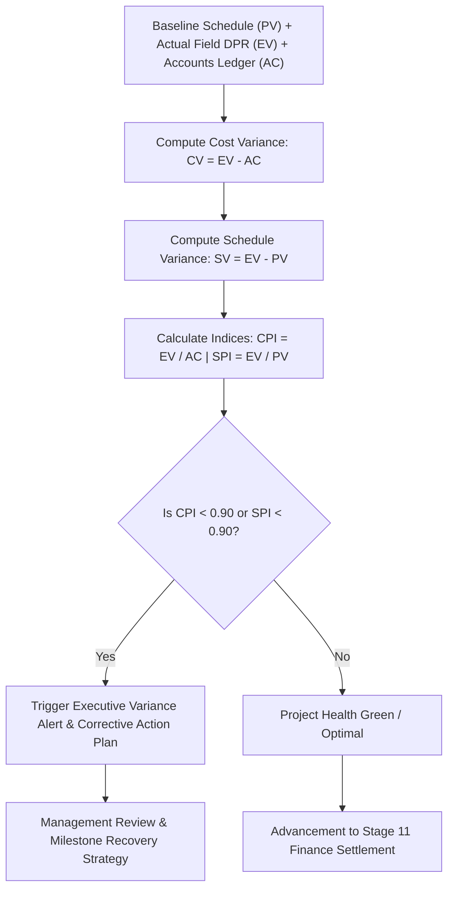

# Stage 10: Project Control & Variance (EVM / SPI / CPI)

## 1. Executive Summary & Business Objective
Monitors project health via Earned Value Management (EVM): Planned Value (PV), Earned Value (EV), Actual Cost (AC), Cost Performance Index (CPI), and Schedule Performance Index (SPI).

This stage constitutes **Stage 10** of the 13-stage PMS lifecycle. It enforces standard operating procedures, quantitative data validation, and approval checks to ensure complete governance before downstream project stages can proceed.

- **Primary Route**: `/pms/project-control`
- **Mongoose Model**: `ProjectControl`

---

## 2. Stage Workflow & Decision Tree

---

## 3. Top 5 KPI Header Cards & Filter Behaviors
Each card displays key live metrics, interactive hover tooltips `(i)`, active ring highlight styling, and triggers table filtering upon clicking.

| Card # | KPI Title | Data Source / Calculation | Filter State Trigger |
|:---|:---|:---|:---|
| **1** | **Tracked Projects** | Projects under active variance and EVM surveillance | `all` |
| **2** | **Within Budget & Time** | Projects operating with CPI >= 1.0 and SPI >= 1.0 | `withinBudget` |
| **3** | **Cost Overrun Risk** | Projects where AC exceeds EV (CPI < 0.95) | `costOverrun` |
| **4** | **Schedule Delayed** | Projects tracking behind baseline timeline (SPI < 0.95) | `scheduleDelayed` |
| **5** | **Critical Variance Ledgers** | Projects requiring immediate executive recovery intervention | `hasVariance` |

---

## 4. Section-by-Section Workflow & Data Breakdown
The module contains 5 structured functional sections. Each section must be completed and marked verified to enable stage advancement.

### Section 1: Earned Value Metrics (Planned Value PV, Earned Value EV, Actual Cost AC)
- **Objective**: Capture and validate all required operational data for earned value metrics (planned value pv, earned value ev, actual cost ac).
- **Data Attributes**: Validated schema fields, attachments, timestamps, and officer IDs.
- **Completion Check**: Requires 100% mandatory fields populated and verified.

### Section 2: Performance Indices (Cost Performance Index CPI, Schedule Performance Index SPI)
- **Objective**: Capture and validate all required operational data for performance indices (cost performance index cpi, schedule performance index spi).
- **Data Attributes**: Validated schema fields, attachments, timestamps, and officer IDs.
- **Completion Check**: Requires 100% mandatory fields populated and verified.

### Section 3: Estimate at Completion (EAC, VAC, forecasted project completion date)
- **Objective**: Capture and validate all required operational data for estimate at completion (eac, vac, forecasted project completion date).
- **Data Attributes**: Validated schema fields, attachments, timestamps, and officer IDs.
- **Completion Check**: Requires 100% mandatory fields populated and verified.

### Section 4: Milestone Variance Analysis (delays by work package and critical path impact)
- **Objective**: Capture and validate all required operational data for milestone variance analysis (delays by work package and critical path impact).
- **Data Attributes**: Validated schema fields, attachments, timestamps, and officer IDs.
- **Completion Check**: Requires 100% mandatory fields populated and verified.

### Section 5: Executive Mitigation Strategy (contingency budget releases, gang headcount increases)
- **Objective**: Capture and validate all required operational data for executive mitigation strategy (contingency budget releases, gang headcount increases).
- **Data Attributes**: Validated schema fields, attachments, timestamps, and officer IDs.
- **Completion Check**: Requires 100% mandatory fields populated and verified.

---

## 5. Stage Progression & Checklist Automation Rules
- **Automatic Gating**: When all 5 section checklists are marked `done`, the document status automatically updates to `approved`.
- **Audit History**: Every transition creates an immutable record in `statusHistory` with user ID, previous status, next status, and timestamp.
- **Downstream Advancement**: Approving this stage automatically spawns or unlocks the subsequent stage on the project's master stage rail.

---

## 6. Manager Presentation Talking Points
- **Provides senior management an instant pulse check on project profitability and schedule health.**
- **Uses standard PMI-compliant Earned Value formulas (CPI = EV/AC, SPI = EV/PV).**
- **Contextual pagination explicitly states "project variance ledgers".**
