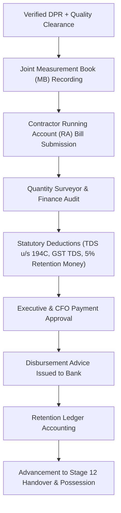

# Stage 11: Finance & Contractor RA Billing Engine

## 1. Executive Summary & Business Objective
Governs contractor Running Account (RA) billing: Measurement Book (MB) verification, statutory TDS/GST deductions, retention money withholding, and executive disbursement sign-off.

This stage constitutes **Stage 11** of the 13-stage PMS lifecycle. It enforces standard operating procedures, quantitative data validation, and approval checks to ensure complete governance before downstream project stages can proceed.

- **Primary Route**: `/pms/finance`
- **Mongoose Model**: `PmsFinance`

---

## 2. Stage Workflow & Decision Tree

---

## 3. Top 5 KPI Header Cards & Filter Behaviors
Each card displays key live metrics, interactive hover tooltips `(i)`, active ring highlight styling, and triggers table filtering upon clicking.

| Card # | KPI Title | Data Source / Calculation | Filter State Trigger |
|:---|:---|:---|:---|
| **1** | **Tracked Ledgers** | Total project financial accounts under active governance | `all` |
| **2** | **Gross Disbursed** | Cumulative contractor payouts cleared and paid | `hasOutflow` |
| **3** | **Pending Clearances** | Approved RA bills pending treasury disbursement | `pendingClearance` |
| **4** | **Certified & Settled** | Projects with audited contractor bill closures | `approved` |
| **5** | **Contractor RA Billings** | Total running account bill value certified to date | `hasRaBills` |

---

## 4. Section-by-Section Workflow & Data Breakdown
The module contains 5 structured functional sections. Each section must be completed and marked verified to enable stage advancement.

### Section 1: Measurement Book (MB) Ledger (jointly measured items, quantity offsets)
- **Objective**: Capture and validate all required operational data for measurement book (mb) ledger (jointly measured items, quantity offsets).
- **Data Attributes**: Validated schema fields, attachments, timestamps, and officer IDs.
- **Completion Check**: Requires 100% mandatory fields populated and verified.

### Section 2: RA Bill Inward Register (bill number, invoice date, claiming contractor, claimed gross)
- **Objective**: Capture and validate all required operational data for ra bill inward register (bill number, invoice date, claiming contractor, claimed gross).
- **Data Attributes**: Validated schema fields, attachments, timestamps, and officer IDs.
- **Completion Check**: Requires 100% mandatory fields populated and verified.

### Section 3: Deductions & Withholding (5% security retention, 1% labour cess, 2% TDS, advance recovery)
- **Objective**: Capture and validate all required operational data for deductions & withholding (5% security retention, 1% labour cess, 2% tds, advance recovery).
- **Data Attributes**: Validated schema fields, attachments, timestamps, and officer IDs.
- **Completion Check**: Requires 100% mandatory fields populated and verified.

### Section 4: Net Payment Certification (approved payable amount, payment mode, UTR number)
- **Objective**: Capture and validate all required operational data for net payment certification (approved payable amount, payment mode, utr number).
- **Data Attributes**: Validated schema fields, attachments, timestamps, and officer IDs.
- **Completion Check**: Requires 100% mandatory fields populated and verified.

### Section 5: P&L Cost Ledger Summary (actual capital cost vs baseline budget allocations)
- **Objective**: Capture and validate all required operational data for p&l cost ledger summary (actual capital cost vs baseline budget allocations).
- **Data Attributes**: Validated schema fields, attachments, timestamps, and officer IDs.
- **Completion Check**: Requires 100% mandatory fields populated and verified.

---

## 5. Stage Progression & Checklist Automation Rules
- **Automatic Gating**: When all 5 section checklists are marked `done`, the document status automatically updates to `approved`.
- **Audit History**: Every transition creates an immutable record in `statusHistory` with user ID, previous status, next status, and timestamp.
- **Downstream Advancement**: Approving this stage automatically spawns or unlocks the subsequent stage on the project's master stage rail.

---

## 6. Manager Presentation Talking Points
- **Zero unverified payments: every rupee disbursed is matched against verified MB quantities.**
- **Automates retention money accounting (held for release after the defect liability period).**
- **Pagination displays exact "finance accounts" count.**
