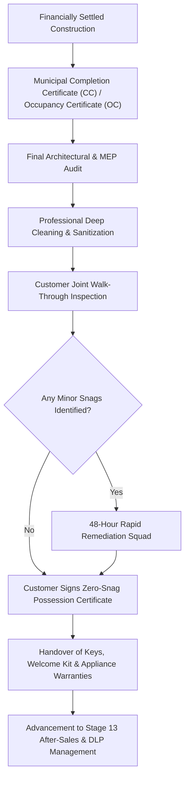

# Stage 12: Handover & Customer Possession Management

## 1. Executive Summary & Business Objective
Orchestrates the transition from construction to customer occupancy: municipal completion certificate, deep cleaning, pre-possession homebuyer walk-through, zero-snag sign-off, and handover of keys/welcome kit.

This stage constitutes **Stage 12** of the 13-stage PMS lifecycle. It enforces standard operating procedures, quantitative data validation, and approval checks to ensure complete governance before downstream project stages can proceed.

- **Primary Route**: `/pms/handover`
- **Mongoose Model**: `PmsHandover`

---

## 2. Stage Workflow & Decision Tree

---

## 3. Top 5 KPI Header Cards & Filter Behaviors
Each card displays key live metrics, interactive hover tooltips `(i)`, active ring highlight styling, and triggers table filtering upon clicking.

| Card # | KPI Title | Data Source / Calculation | Filter State Trigger |
|:---|:---|:---|:---|
| **1** | **Total Registers** | Total property handover registers under management | `all` |
| **2** | **Possession Delivered** | Units officially handed over with keys and documentation | `possessionCompleted` |
| **3** | **Zero-Snag Verified** | Units certified defect-free by homeowner inspection | `zeroSnagVerified` |
| **4** | **Pending Snags Backlog** | Units undergoing minor cosmetic touch-up remediation | `hasPendingSnags` |
| **5** | **Final Inspections Cleared** | Units with structural and MEP safety clearances issued | `inspectionsCleared` |

---

## 4. Section-by-Section Workflow & Data Breakdown
The module contains 5 structured functional sections. Each section must be completed and marked verified to enable stage advancement.

### Section 1: Statutory Completion Status (Occupancy Certificate, fire safety NOC, electrical inspector clearance)
- **Objective**: Capture and validate all required operational data for statutory completion status (occupancy certificate, fire safety noc, electrical inspector clearance).
- **Data Attributes**: Validated schema fields, attachments, timestamps, and officer IDs.
- **Completion Check**: Requires 100% mandatory fields populated and verified.

### Section 2: Pre-Delivery Inspection (PDI) (cabinet alignment, sanitary fixtures, paint finish)
- **Objective**: Capture and validate all required operational data for pre-delivery inspection (pdi) (cabinet alignment, sanitary fixtures, paint finish).
- **Data Attributes**: Validated schema fields, attachments, timestamps, and officer IDs.
- **Completion Check**: Requires 100% mandatory fields populated and verified.

### Section 3: Deep Cleaning Verification (chemical floor scrub, glass pane polishing, pest control)
- **Objective**: Capture and validate all required operational data for deep cleaning verification (chemical floor scrub, glass pane polishing, pest control).
- **Data Attributes**: Validated schema fields, attachments, timestamps, and officer IDs.
- **Completion Check**: Requires 100% mandatory fields populated and verified.

### Section 4: Customer Joint Handover Checklist (fixtures checklist, meter readings, key counts)
- **Objective**: Capture and validate all required operational data for customer joint handover checklist (fixtures checklist, meter readings, key counts).
- **Data Attributes**: Validated schema fields, attachments, timestamps, and officer IDs.
- **Completion Check**: Requires 100% mandatory fields populated and verified.

### Section 5: Formal Possession Letter (signed acceptance letter, digital document archive)
- **Objective**: Capture and validate all required operational data for formal possession letter (signed acceptance letter, digital document archive).
- **Data Attributes**: Validated schema fields, attachments, timestamps, and officer IDs.
- **Completion Check**: Requires 100% mandatory fields populated and verified.

---

## 5. Stage Progression & Checklist Automation Rules
- **Automatic Gating**: When all 5 section checklists are marked `done`, the document status automatically updates to `approved`.
- **Audit History**: Every transition creates an immutable record in `statusHistory` with user ID, previous status, next status, and timestamp.
- **Downstream Advancement**: Approving this stage automatically spawns or unlocks the subsequent stage on the project's master stage rail.

---

## 6. Manager Presentation Talking Points
- **Guarantees exceptional customer experience through structured zero-snag walk-throughs.**
- **Stores customer-signed possession certificates with exact electrical/water meter readings.**
- **Contextual pagination states "handover registers".**
