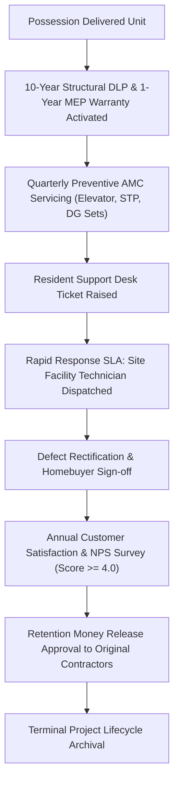

# Stage 13: After-Sales Warranty & DLP Management

## 1. Executive Summary & Business Objective
Governs the terminal project lifecycle: 10-year structural defect liability (DLP), 1-year MEP warranty claims, scheduled Annual Maintenance Contracts (AMC), resident support desk, and Net Promoter Score (NPS) tracking.

This stage constitutes **Stage 13** of the 13-stage PMS lifecycle. It enforces standard operating procedures, quantitative data validation, and approval checks to ensure complete governance before downstream project stages can proceed.

- **Primary Route**: `/pms/after-sales`
- **Mongoose Model**: `PmsAfterSales`

---

## 2. Stage Workflow & Decision Tree

---

## 3. Top 5 KPI Header Cards & Filter Behaviors
Each card displays key live metrics, interactive hover tooltips `(i)`, active ring highlight styling, and triggers table filtering upon clicking.

| Card # | KPI Title | Data Source / Calculation | Filter State Trigger |
|:---|:---|:---|:---|
| **1** | **Total Portfolios** | Projects under active warranty and lifetime facility support | `all` |
| **2** | **Active Warranty Claims** | Open resident punch-list and defect remediation tickets | `hasActiveClaims` |
| **3** | **AMC Visits Executed** | Completed preventive maintenance cycles for shared infrastructure | `amcCompleted` |
| **4** | **Support Queries Resolved** | Resident helpdesk tickets successfully resolved and closed | `supportResolved` |
| **5** | **Customer Satisfaction** | Top rated customer satisfaction score (>= 4.0 / 5.0) | `topRated` |

---

## 4. Section-by-Section Workflow & Data Breakdown
The module contains 5 structured functional sections. Each section must be completed and marked verified to enable stage advancement.

### Section 1: Warranty Coverage Matrix (structural 10 years, water proofing 5 years, MEP 1 year)
- **Objective**: Capture and validate all required operational data for warranty coverage matrix (structural 10 years, water proofing 5 years, mep 1 year).
- **Data Attributes**: Validated schema fields, attachments, timestamps, and officer IDs.
- **Completion Check**: Requires 100% mandatory fields populated and verified.

### Section 2: Defect Liability Claims (ticket classification, SLA response time, assigned maintenance crew)
- **Objective**: Capture and validate all required operational data for defect liability claims (ticket classification, sla response time, assigned maintenance crew).
- **Data Attributes**: Validated schema fields, attachments, timestamps, and officer IDs.
- **Completion Check**: Requires 100% mandatory fields populated and verified.

### Section 3: AMC Schedule Engine (STP biological maintenance, lift annual contract, backup generator)
- **Objective**: Capture and validate all required operational data for amc schedule engine (stp biological maintenance, lift annual contract, backup generator).
- **Data Attributes**: Validated schema fields, attachments, timestamps, and officer IDs.
- **Completion Check**: Requires 100% mandatory fields populated and verified.

### Section 4: Resident Helpdesk Portal (in-app resident query logging, satisfaction rating)
- **Objective**: Capture and validate all required operational data for resident helpdesk portal (in-app resident query logging, satisfaction rating).
- **Data Attributes**: Validated schema fields, attachments, timestamps, and officer IDs.
- **Completion Check**: Requires 100% mandatory fields populated and verified.

### Section 5: Customer NPS & Lifecycle Closure (homeowner feedback, retention release sign-off)
- **Objective**: Capture and validate all required operational data for customer nps & lifecycle closure (homeowner feedback, retention release sign-off).
- **Data Attributes**: Validated schema fields, attachments, timestamps, and officer IDs.
- **Completion Check**: Requires 100% mandatory fields populated and verified.

---

## 5. Stage Progression & Checklist Automation Rules
- **Automatic Gating**: When all 5 section checklists are marked `done`, the document status automatically updates to `approved`.
- **Audit History**: Every transition creates an immutable record in `statusHistory` with user ID, previous status, next status, and timestamp.
- **Downstream Advancement**: Approving this stage automatically spawns or unlocks the subsequent stage on the project's master stage rail.

---

## 6. Manager Presentation Talking Points
- **Protects brand reputation by ensuring swift resolution of post-handover customer issues.**
- **Governs final release of contractor retention money based on defect-free warranty periods.**
- **Features explicit "after-sales portfolios" pagination and top-rated customer satisfaction card.**
