# Diagram 01: PMS End-to-End Enterprise Lifecycle Flow

This diagram illustrates the complete, unbroken real estate development lifecycle in TaskFlow ERP: from raw land discovery to legal checks, government licensing, baseline freezing, civil execution, and final customer delivery.

```mermaid
flowchart TD
    %% Styling Classes
    classDef land fill:#EBF5FF,stroke:#0A5BB0,stroke-width:2px,color:#0A5BB0;
    classDef legal fill:#FEF3C7,stroke:#D97706,stroke-width:2px,color:#92400E;
    classDef baseline fill:#EDE9FE,stroke:#7C3AED,stroke-width:2px,color:#5B21B6;
    classDef site fill:#DCFCE7,stroke:#16A34A,stroke-width:2px,color:#166534;
    classDef handover fill:#FCE7F3,stroke:#DB2777,stroke-width:2px,color:#9D174D;
    classDef crm fill:#E0E7FF,stroke:#4F46E5,stroke-width:2px,color:#3730A3;

    subgraph ACT1 ["Act 1: Land Discovery & Legal Clearance"]
        A1["1. Plot Discovery & Scouting<br/>(Area, Khasra, Landowner)"]:::land
        A2["2. Survey & Feasibility Calculation<br/>(ROI & Cost-Yield Check)"]:::land
        A3["3. Approved Plot Package Generated"]:::land
        A4["4. 4-Stage Legal Due Diligence<br/>(Title, EC, Revenue, Advocate Opinion)"]:::legal
        A5["5. PM / Director Decision Gate<br/>(Clear Title Clearance)"]:::legal
        A6["6. Land Purchase & Registry Execution<br/>(Sub-Registrar Deed & Mutation)"]:::land
        A1 --> A2 --> A3 --> A4 --> A5 --> A6
    end

    subgraph ACT2 ["Act 2: Licensing & Baseline Lock"]
        B1["7. Change of Land Use (CLU) & Layout Sanction"]:::baseline
        B2["8. Statutory NOCs & RERA Registration"]:::baseline
        B3["9. BOQ Preparation (Civil, MEP, Road)"]:::baseline
        B4["10. Director Baseline Sign-Off<br/>(IMMUTABLE BASELINE LOCK)"]:::baseline
        A6 --> B1 --> B2 --> B3 --> B4
    end

    subgraph ACT3 ["Act 3: Execution & Control"]
        C1["11. Pre-Site Setup & Contractor Work Orders"]:::site
        C2["12. Daily DPR Submissions (&lt;90s Mobile)<br/>(Labor, Material, Geo-Photos)"]:::site
        C3["13. Quality Inspection & Snag Resolution"]:::site
        C4["14. Measurement Book (MB) & RA Billing"]:::site
        B4 --> C1 --> C2 --> C3 --> C4
    end

    subgraph ACT4 ["Act 4: Customer Handover & CRM Link"]
        D1["15. Statutory Occupancy Certificate (OC)"]:::handover
        D2["16. Joint Pre-Possession Walkthrough"]:::handover
        D3["17. Zero Accounts Dues Clearance"]:::handover
        D4["18. Key Handover & Possession Letter"]:::handover
        D5["19. Sync to CRM Lead: Possession Taken"]:::crm
        D6["20. 12-Month Defect Liability Period (DLP)"]:::handover
        C4 --> D1 --> D2 --> D3 --> D4 --> D5 --> D6
    end
```



---

## Data & Artifact Flow Across Enterprise Boundaries

```
[ PMS Land Acquisition ] ──(Approved Plot Package)──> [ PMS Legal Verification ]
                                                                │
                                                    (Title Clearance Sign-off)
                                                                ▼
[ CRM Sales / Enquiries ] ◄──(Active Project Master)─── [ PMS Approvals & RERA ]
            │                                                   │
     (Buyer Booked)                                     (Baseline Locked)
            │                                                   ▼
            │                                        [ PMS Construction Execution ]
            │                                                   │
            │                                            (Building Completed)
            │                                                   ▼
            └──────────────(Joint Walkthrough)─────────> [ PMS Handover Management ]
                                                                │
                                                         (Possession Letter)
                                                                ▼
                                                     [ CRM Status: Handed Over ]
```
