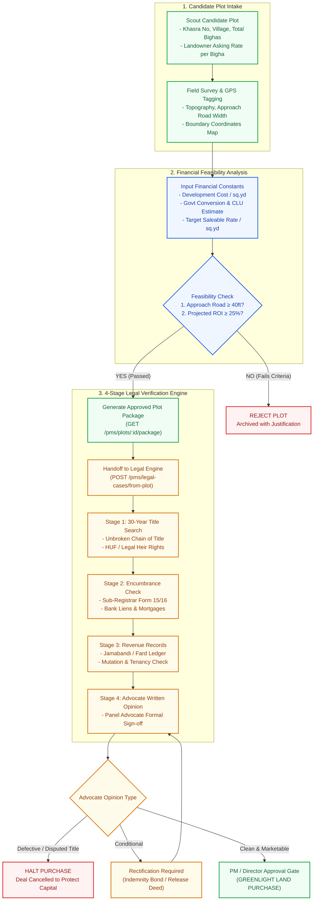

# Diagram 02: Land Acquisition to Legal Verification Gateway

This diagram illustrates how raw land scouting flows into the financial feasibility engine, packages into an **Approved Plot Package**, and gets vetted through the unbreakable **4-Stage Legal Verification Gate**.

