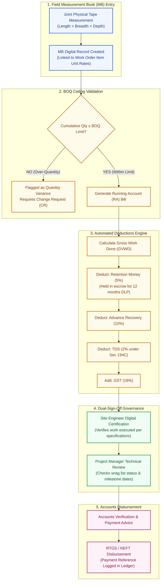

# Diagram 04: Contractor Measurement Book (MB) & RA Billing Lifecycle

This diagram demonstrates how physical site measurements translate into verified Running Account (RA) bills, pass through statutory and retention deduction calculations, and get disbursed.

