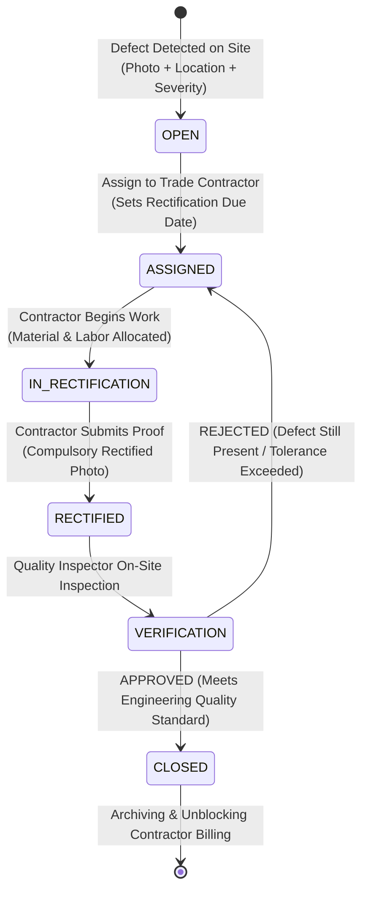

# Diagram 05: Quality Inspection & Closed-Loop Snag Lifecycle

This diagram demonstrates how construction defects are captured on site, assigned to trade contractors, rectified with mandatory photo evidence, re-inspected, and closed.



---

## Detailed Step-by-Step Actor Matrix

```
┌─────────────────┬───────────────────┬─────────────────────┬──────────────────┐
│ STAGE           │ ACTOR             │ REQUIRED INPUT      │ SUCCESS OUTCOME  │
├─────────────────┼───────────────────┼─────────────────────┼──────────────────┤
│ 1. Raise Snag   │ Quality Engineer  │ • GPS location      │ Snag Ticket SNG- │
│                 │                   │ • Severity category │ 089 generated    │
│                 │                   │ • Defect photograph │                  │
├─────────────────┼───────────────────┼─────────────────────┼──────────────────┤
│ 2. Assign Trade │ Project Manager   │ • Select Contractor │ Auto-alert sent  │
│                 │                   │ • Due Date deadline │ to contractor    │
├─────────────────┼───────────────────┼─────────────────────┼──────────────────┤
│ 3. Rectify Work │ Contractor Mason  │ • Repairs defect    │ Ready for check  │
├─────────────────┼───────────────────┼─────────────────────┼──────────────────┤
│ 4. Submit Proof │ Contractor / Lead │ • Rectified photo   │ Status: RECTIFIED│
├─────────────────┼───────────────────┼─────────────────────┼──────────────────┤
│ 5. Physical Sign│ Quality Engineer  │ • Re-measure check  │ Status: CLOSED   │
│    Off          │                   │ • Sign-off remark   │ Milestone unlocked│
└─────────────────┴───────────────────┴─────────────────────┴──────────────────┘
```
